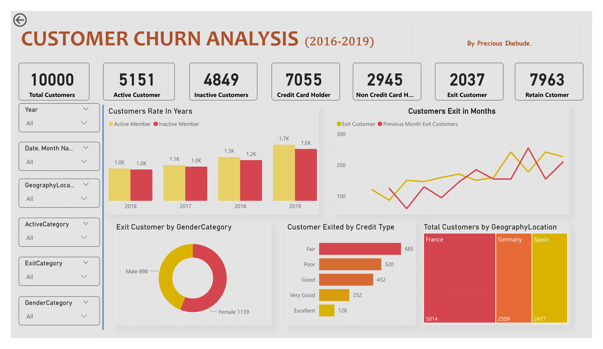
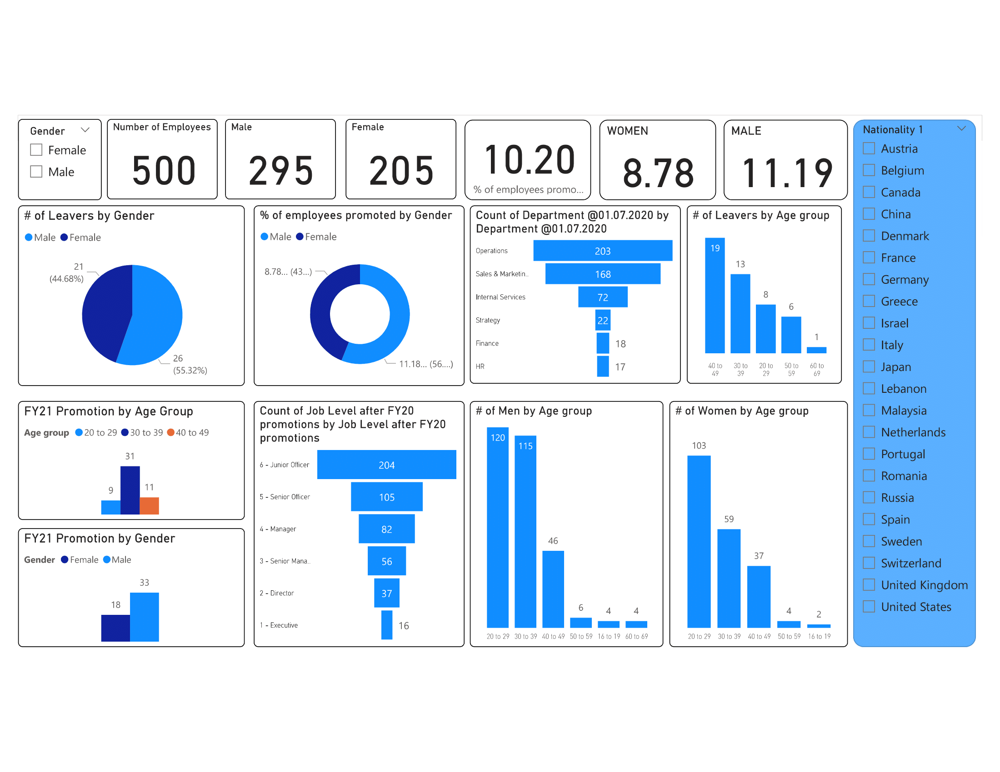

# Executive Power BI Decision Suite: Telecom Retention, Contact Center SLA & Workforce Diversity

> Three enterprise Power BI workbooks built on 12,543 operational records (`7,043` telecom subscribers, `5,000` contact-center calls, and `500` HR promotion/attrition records): pinpoints \$139.13k/month in at-risk MRR, a 7.69x technical-ticket churn multiplier, and an 18.92% contact-center call abandonment gap.



## Problem

Executive leadership across Customer Retention, Contact Center Operations, and People Analytics needed unified, self-serve Power BI dashboards that move beyond passive KPI reporting to isolate the root operational drivers of monthly recurring revenue (MRR) churn, inbound SLA breaches, and leadership pipeline gender gaps.

## Datasets & Power BI Workbooks

1. **Telecom Customer Retention (`Churn Analysis Dashboard.pbix` / [`Churn Dataset.xlsx`](Churn%20Dataset.xlsx)):**
   - **7,043** subscribers across **23** billing, contract, service-tier, and support-ticket attributes (`MonthlyCharges`, `TotalCharges`, `Contract`, `InternetService`, `PaymentMethod`, `numAdminTickets`, `numTechTickets`, `Churn`).
2. **Inbound Contact Center SLA (`Pwc Dashboard.pbix` / [`PwC CallDataset.xlsx`](PwC%20CallDataset.xlsx)):**
   - **5,000** inbound customer support calls across **8** agents and **5** issue queues (`Admin Support`, `Contract related`, `Payment related`, `Streaming`, `Technical Support`), tracking `Answered (Y/N)`, `Resolved`, `Speed of answer in seconds`, `AvgTalkDuration`, and `Satisfaction rating` (1–5 scale).
3. **HR Diversity & Promotion Equity (`Diversity & Inclusion.pbix` / [`Diversity Dashboard.xlsx`](Diversity%20Dashboard.xlsx)):**
   - **500** corporate employees across **32** organizational attributes (`Gender`, `Job Level before/after FY20/FY21 promotions`, `FY19/FY20 Performance Rating`, `New hire FY20?`, `FY20 leaver?`, `Age group`, `Department`).

## Methodology & DAX Measures

Each `.pbix` semantic model uses a star-schema layout with explicit DAX measure tables separating base counts, conditional rates, and revenue-at-risk calculations:

```dax
// 1. Customer Churn Rate & Monthly Recurring Revenue (MRR) at Risk
Churn Rate % =
DIVIDE(
    CALCULATE(COUNTROWS('Churn'), 'Churn'[Churn] = "Yes"),
    COUNTROWS('Churn'),
    0
)

MRR Lost to Churn ($) =
CALCULATE(
    SUM('Churn'[MonthlyCharges]),
    'Churn'[Churn] = "Yes"
)

// 2. Contact Center First-Contact Resolution (Answered Cohort) & Abandonment Rate
Call Abandonment Rate % =
DIVIDE(
    CALCULATE(COUNTROWS('Calls'), 'Calls'[Answered (Y/N)] = "N"),
    COUNTROWS('Calls'),
    0
)

Resolution Rate (Answered Calls) % =
DIVIDE(
    CALCULATE(COUNTROWS('Calls'), 'Calls'[Answered (Y/N)] = "Y", 'Calls'[Resolved] = "Y"),
    CALCULATE(COUNTROWS('Calls'), 'Calls'[Answered (Y/N)] = "Y"),
    0
)
```

## Key Quantitative Findings

### 1. Telecom Subscriber Churn (`7,043` Subscribers, `26.54%` Overall Churn)

| Segment Dimension | Cohort | Subscribers ($n$) | Churn Rate (%) | Relative Risk vs Best Cohort |
|---|---|---:|---:|---:|
| **Contract Type** | Month-to-month | 3,875 | **42.71%** | **15.08x** vs Two-Year |
| **Contract Type** | One year | 1,473 | 11.27% | 3.98x vs Two-Year |
| **Contract Type** | Two year | 1,695 | **2.83%** | 1.00x (Baseline) |
| **Internet Service** | Fiber optic | 3,096 | **41.89%** | 2.21x vs DSL |
| **Internet Service** | DSL | 2,421 | 18.96% | 1.00x (Baseline) |
| **Internet Service** | No Internet | 1,526 | 7.40% | — |
| **Payment Method** | Electronic check | 2,365 | **45.29%** | **2.97x** vs Auto Credit Card |
| **Payment Method** | Mailed check | 1,612 | 19.11% | 1.25x |
| **Payment Method** | Bank transfer (auto) | 1,544 | 16.71% | 1.10x |
| **Payment Method** | Credit card (auto) | 1,522 | **15.24%** | 1.00x (Baseline) |

- **\$139,130.85 in Monthly Recurring Revenue (`30.50%` of total `\$456,116.60` MRR)** is lost to churned subscribers (`1,869` churned accounts paying an average of `\$74.44/mo` vs `\$61.27/mo` for retained accounts).
- **The 7.69x Technical Support Ticket Trigger:** Churned subscribers logged an average of **1.163 technical tickets** per account compared to just **0.151 technical tickets** for retained subscribers—explaining why high-ARPU `Fiber optic` users (`41.89%` churn) defect when service stability degrades.

### 2. Inbound Contact Center Performance (`5,000` Calls)

| Support Queue (`Topic`) | Inbound Calls ($n$) | Answer Rate (%) | Abandonment Rate (%) | Mean CSAT (1–5) |
|---|---:|---:|---:|---:|
| **Streaming** | 1,022 | **82.88%** | 17.12% | 3.40 |
| **Admin Support** | 976 | 81.45% | 18.55% | **3.43** |
| **Payment related** | 1,007 | 81.23% | 18.77% | 3.40 |
| **Contract related** | 976 | 80.84% | 19.16% | 3.38 |
| **Technical Support** | 1,019 | **79.00%** | **21.00%** | 3.41 |
| **Total / Overall** | **5,000** | **81.08%** | **18.92%** | **3.40** |

- **Queue capacity bottleneck:** Overall call answer rate is **81.08%** (`4,054` answered, `946` abandoned) with a mean speed of answer of **67.52 seconds**. Once answered, agents resolve **89.94%** of calls (`3,646` resolved out of `4,054` answered; `72.92%` of total inbound volume).
- **Technical Support abandonment link:** `Technical Support` suffers the highest abandonment rate at **21.00%** (`214` dropped calls), directly compounding the `7.69x` technical-ticket churn risk identified in the retention workbook.

### 3. Workforce Diversity & Promotion Equity (`500` Employees)



- **Headcount vs Promotion Gap:** Across the 500-employee workforce, representation is **59.0% Male (`295`) / 41.0% Female (`205`)**. However, in the FY21 promotion cycle, **11.19% of male employees** were promoted compared to **8.78% of female employees** (a **1.27x male promotion rate advantage**).
- **Turnover asymmetry:** FY20 voluntary/involuntary attrition ran at **10.24% for female employees** versus **8.81% for male employees**, widening the representation gap at senior job levels.

## Executive Recommendations

1. **Autopay + Annual Contract Migration Campaign:** Offer a `\$5/month` bill credit for `Month-to-month` + `Electronic check` subscribers (`45.29%` churn) who enroll in automatic credit-card/bank billing and a 12-month contract (`11.27%` churn), protecting `\$139.1k` in monthly recurring revenue.
2. **Proactive Tech-Ticket Escalation at $\ge 2$ Tickets:** Automatically route any `Fiber optic` subscriber opening a second technical ticket within 60 days to Tier-2 engineering and reallocate peak-hour staffing to the `Technical Support` call queue to cut its `21.00%` abandonment rate below `10%`.
3. **Calibrated Promotion Slate Reviews:** Institute mandatory gender-balanced promotion slate audits at Mid/Senior Job Levels to close the `11.19% vs 8.78%` FY21 promotion velocity gap.

## How to Open / Run

1. Open [`Churn Analysis Dashboard.pbix`](Churn%20Analysis%20Dashboard.pbix), [`Pwc Dashboard.pbix`](Pwc%20Dashboard.pbix), or [`Diversity & Inclusion.pbix`](Diversity%20&%20Inclusion.pbix) in **Microsoft Power BI Desktop**.
2. To inspect the PDF executive exports directly without Power BI Desktop, view [`PwC Churn Analysis Dashboard.pdf`](PwC%20Churn%20Analysis%20Dashboard.pdf), [`Pdf Report(Pwc Dashboard).pdf`](Pdf%20Report(Pwc%20Dashboard).pdf), and [`Diversity & Inclusion pdf.pdf`](Diversity%20&%20Inclusion%20pdf.pdf).

## Post kit

- [`POST_LINKEDIN.md`](POST_LINKEDIN.md) — Executive narrative connecting the `21.00%` Tech Support call abandonment rate to the `7.69x` technical-ticket churn spike.
- [`POST_X.md`](POST_X.md) — 6-tweet thread summarizing all three Power BI case studies.
