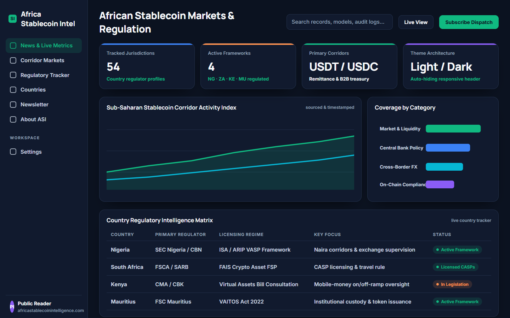
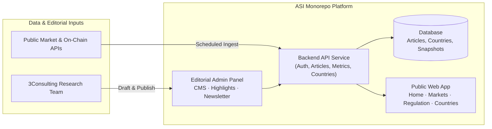

# Africa Stablecoin Intelligence (ASI) — Market & Regulatory Platform (Case Study)

> **Industry Case Study · 3Consulting Limited**
> Market data, on-chain stablecoin metrics, country-by-country regulatory tracking, and editorial publishing platform covering stablecoin adoption across Africa.

- **Company:** 3Consulting Limited (Lagos, Nigeria)
- **My Role:** BI Scientist || AI/ML Engineer (Nov 2025 – present) — data source research, market metrics pipeline, public/admin UI theme engineering (Light/Dark/System), deployment & search-console indexing
- **Public site (planned):** [africastablecoinintelligence.com](https://africastablecoinintelligence.com) *(deployment pending verification)*
- **Codebase Status:** Proprietary (3Consulting Limited). This page is an engineering case study; no proprietary source code is published here.

---

## 1. Problem & Why It Matters

Stablecoins play a major role in cross-border payments, treasury management, and remittance corridors across Africa, yet reliable data on country-level volumes, exchange corridors, and regulatory posture is fragmented across central bank circulars, on-chain explorers, and global reports.

**Africa Stablecoin Intelligence (ASI)** brings market data and regulatory tracking into one platform:
- **Market & Corridor Metrics:** Tracks stablecoin market cap, African corridor activity, and local adoption indicators with clear data provenance.
- **Regulatory Intelligence by Country:** Maps central bank and securities-regulator frameworks across African jurisdictions.
- **Editorial Admin & Newsletter:** Gives the research team a dedicated admin workspace to draft, edit, schedule, and publish market and regulatory dispatches.

---

## 2. System Architecture

---

## 3. My Contributions

- **Data Source Reference & Market Schema:** Documented and structured the market and regulatory indicators feeding the home, markets, and countries views so every metric displays its source and timestamp.
- **Frontend & Admin Polish:** Built the Light/Dark/System theme architecture across both the public site and editorial admin panel, responsive mobile navigation, auto-hiding scroll header, and animated hero highlights card.
- **Launch & Indexing Operations:** Prepared deployment environment variables, Google Search Console verification, and deployment runbooks for `africastablecoinintelligence.com`.

---

## 4. Tech Stack

| Layer | Technologies |
|---|---|
| **Frontend & Admin** | TypeScript, React / Next.js, Tailwind CSS, CSS Custom Properties (Light/Dark/System theme tokens) |
| **Backend & Data** | Node.js / Python API services, relational database storage, REST endpoints |
| **Deployment & Ops** | Docker, Linux hosting, Google Search Console indexing, automated build scripts |
