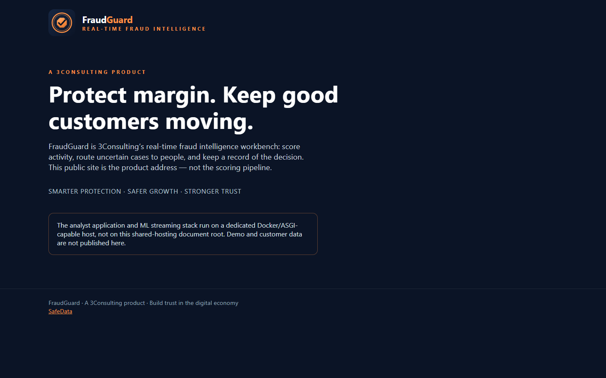
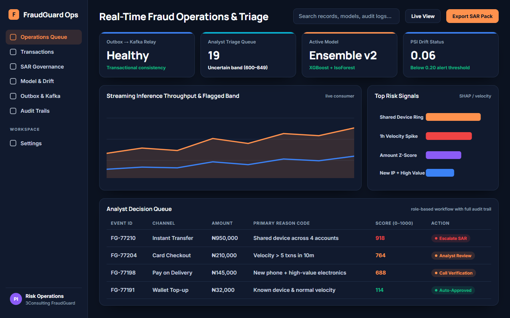
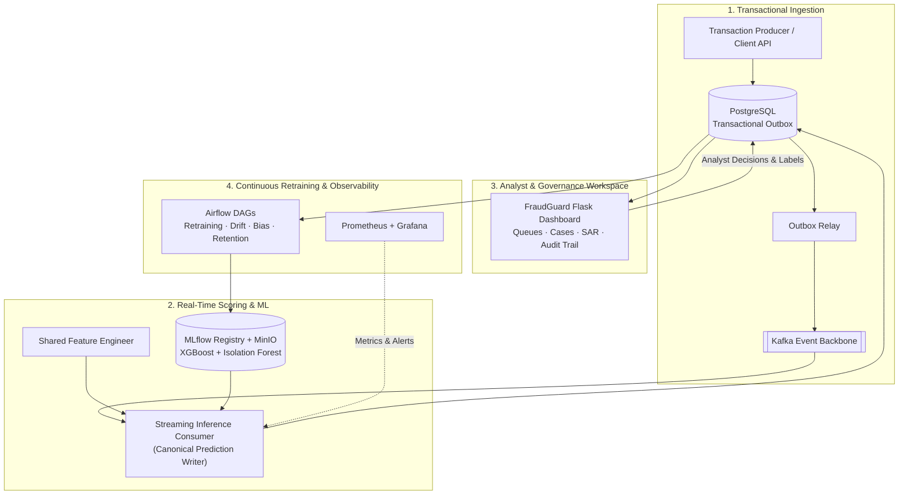

# FraudGuard — Real-Time Transaction Fraud Intelligence (Case Study)

> **Industry Case Study · 3Consulting Limited**
> End-to-end fraud prevention and analyst decision-support platform designed for digital commerce, payments, and fintech operators. Scores transactions 0–1000, routes uncertain cases to human analysts, and retrains on analyst feedback.

- **Company:** 3Consulting Limited (Lagos, Nigeria)
- **My Role:** Junior Data Analyst (AI Assurance & Solutions) — feature engineering, ensemble scoring pipeline, MLflow/Airflow MLOps workflows, analyst dashboard & governance reporting
- **Public site (planned):** [fraudguard.3consult-ng.com](https://fraudguard.3consult-ng.com) *(deployment pending verification)*
- **Codebase Status:** Proprietary (3Consulting Limited). This page is an engineering case study; no proprietary source code is published here. *(For my personal, open-source implementation of this problem with reproducible benchmarks, see [`products/moniguard`](../../products/moniguard/).)*

| Public Product Site (`fraudguard.3consult-ng.com`) | Real-Time Risk Scoring & SAR Analyst Queue |
|---|---|
|  |  |

---

## 1. Problem & Why It Matters

Payment processors, e-commerce merchants, and mobile-money operators in emerging markets face high-velocity fraud patterns—account takeovers, device/IP sharing rings, rapid balance drains, and pay-on-delivery abuse. Relying on static rules alone creates high false-positive rates that block genuine customers, while unassisted manual review cannot keep up with transaction volume.

**FraudGuard** pairs an ML scoring pipeline with a structured operations workspace:
- **Low-risk transactions** pass automatically.
- **Uncertain transactions** enter a prioritized analyst queue with plain-language risk reasons, entity link context, and keyboard-driven triage.
- **Confirmed outcomes** feed back into scheduled Airflow retraining jobs tracked in MLflow, with governance and SAR (Suspicious Activity Report) workflows built in.

---

## 2. System Architecture

---

## 3. My Contributions

- **Feature Engineering & Ensemble Scoring:** Designed velocity, behavioural deviation, and shared-entity (device/IP/phone) features feeding a calibrated XGBoost + Isolation Forest ensemble, ensuring training and inference share the same feature definitions.
- **Streaming & Storage Reliability:** Worked on the transactional outbox pattern between PostgreSQL and Kafka so transaction ingestion and canonical fraud predictions remain consistent under service restarts.
- **MLOps & Governance Automation:** Built Airflow DAGs for model retraining, model promotion, data-drift monitoring, and compliance reporting, logging parameters, metrics, and artefacts to MLflow and MinIO.
- **Analyst Operations UI & Commercial Readiness:** Contributed to the Flask operations dashboard (alert triage, audit trails, light/dark theme system) and the commercial readiness audit documentation.

---

## 4. Tech Stack

| Layer | Technologies |
|---|---|
| **ML & Data** | Python, XGBoost, Scikit-learn (Isolation Forest, calibration), Pandas, NumPy |
| **Streaming & Storage** | Apache Kafka, Zookeeper, PostgreSQL, Redis, MinIO (S3-compatible object store) |
| **MLOps & Orchestration** | Apache Airflow (CeleryExecutor), MLflow Tracking & Model Registry |
| **Serving & Web UI** | Flask (Analyst Dashboard & REST APIs), Gunicorn, Jinja2 |
| **Observability & Infra** | Docker Compose, Prometheus, Grafana, Alertmanager, GitHub Actions CI |
