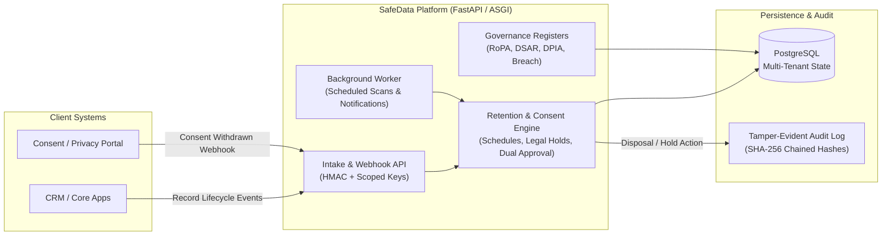

# SafeData — Automated Data Retention & Consent Governance (Case Study)

> **Industry Case Study · 3Consulting Limited**
> Automated data-lifecycle governance platform that tracks retention schedules, processes consent withdrawals via API/webhooks, enforces legal holds and dual approvals, and produces auditable disposal records.

- **Company:** 3Consulting Limited (Lagos, Nigeria)
- **My Role:** Junior Data Analyst (AI Assurance & Solutions) — backend data workflows, retention-engine scheduling logic, PostgreSQL migration & test suite, CI security/lint pipeline
- **Product URL:** [safedata.3consult-ng.com](https://safedata.3consult-ng.com)
- **Codebase Status:** Proprietary (3Consulting Limited). This page is an engineering case study; no proprietary source code is published here.

---

## 1. Problem & Why It Matters

Organisations subject to the Nigeria Data Protection Act (NDPA), GDPR, and sector-specific regulations often keep personal data long after its lawful purpose has expired—or fail to dispose of records when a user withdraws consent. Manual spreadsheet tracking breaks down across multiple departments, leaving companies exposed to regulatory penalties and unnecessary breach liability.

**SafeData** ("Keep what you must. Release what you should.") solves this with two tightly integrated capabilities:
1. **Retention Tracking:** Inventories data categories, applies jurisdiction-aware retention periods after active use ends, routes eligible records through review/dual-approval workflows, and logs cryptographic proof of disposal.
2. **Consent Withdrawal Tracking:** Connects to client systems via REST APIs and webhooks so that when a data subject withdraws consent, the affected record enters a tracked disposal countdown governed by applicable retention and legal-hold rules.

---

## 2. System Architecture

---

## 3. My Contributions

- **Retention & Consent Lifecycle Logic:** Worked on the rule evaluation pipeline that computes disposal eligibility dates from category retention schedules and consent-withdrawal timestamps while respecting active legal holds and high-risk dual-approval gates.
- **PostgreSQL Reliability & Test Suite:** Fixed foreign-key and tenant-scoping test fixtures across the PostgreSQL test suite so every retention and governance test runs cleanly in isolated transactions.
- **CI/CD & Security Hygiene:** Built the GitHub Actions CI workflow covering Python linting, automated PostgreSQL integration tests, dependency vulnerability auditing, and secret scanning.
- **Multi-Currency & Commercial Readiness:** Contributed to the product restructuring that unified the Retention and Consent modules with localized pricing support and audit documentation.

---

## 4. Tech Stack

| Layer | Technologies |
|---|---|
| **Backend & API** | Python, FastAPI (ASGI), SQLAlchemy, Alembic, Pydantic |
| **Frontend UI** | Jinja2 Server-Rendered Templates, Responsive CSS (Light/Dark/System themes) |
| **Database** | PostgreSQL (production/CI), SQLite (local development) |
| **Security & Auth** | Role-Based Access Control (Admin, DPO, Data Owner), TOTP 2FA, HMAC Webhook Signatures, SHA-256 Audit Hashing |
| **DevOps & CI** | Docker, GitHub Actions (lint, PostgreSQL test matrix, secret & dependency scanning), cPanel / Linux VPS deployment |
