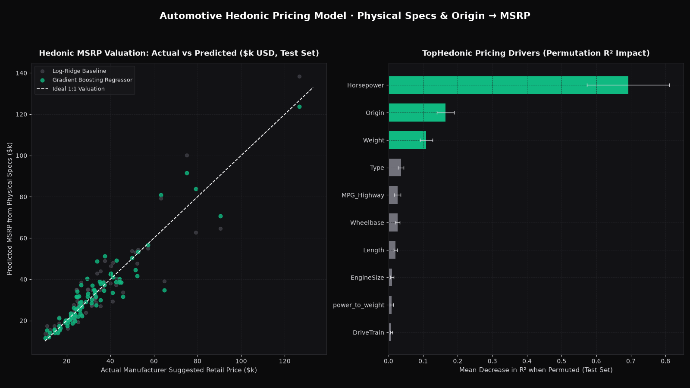

# Automotive Hedonic Pricing & Powertrain Analysis

> Predicts vehicle MSRP from physical specifications and regional origin without dealer-invoice leakage: $R^2 = 0.8660$, MAPE `12.27%`, and MAE `\$4,186.99` (13.3% lower error than log-linear Ridge baseline).



## Problem

Automotive valuation and fleet procurement teams need to benchmark whether a vehicle's Manufacturer Suggested Retail Price (`MSRP`) reflects its underlying mechanical specifications (`Horsepower`, `EngineSize`, `Weight`, `MPG`, `DriveTrain`) or a regional brand premium (`Origin`). A common mistake on this dataset is leaving `Invoice` (dealer cost) in the predictor matrix—which leaks the target because `Invoice` is a fixed ~92% markdown of `MSRP`. This pipeline builds a leak-free hedonic pricing model and decomposes the European vs Asian/US brand premium.

## Data

- **Source:** Multi-Manufacturer Vehicle Specifications & Pricing Dataset (`CarsDataset.csv`)
- **Size:** 428 vehicles across 38 makes, 6 body types (`Sedan`, `SUV`, `Sports`, `Wagon`, `Truck`, `Hybrid`), and 3 regional origins (`Asia` 158, `USA` 147, `Europe` 123); 342 train / 86 origin-stratified test vehicles
- **Licence:** Public educational dataset (MIT code licence)
- **Period covered:** Cross-sectional multi-segment model year catalog (`mean MSRP \$32,774.86`, `median MSRP \$27,635.00`)

## Approach

1. **Currency parsing & rotary-engine imputation:** Parsed `$` and `,` characters from `MSRP` and `Invoice`, stripped trailing whitespace across categorical strings, and imputed the 2 missing `Cylinders` records (Mazda RX-8 rotary engines) to `4.0` cylinders.
2. **Domain feature engineering & strict leakage firewall:**
   - `power_to_weight = (Horsepower / Weight) * 1000` (hp per 1,000 lbs)
   - `mpg_combined = 0.55 * MPG_City + 0.45 * MPG_Highway` (EPA combined cycle formula)
   - `dealer_margin_pct = ((MSRP - Invoice) / MSRP) * 100` (computed for descriptive segment auditing only; **strictly excluded** alongside `Invoice` from all model predictors).
3. **Log-MSRP transformation & model comparison:** Because luxury and exotic trims create strong positive skewness in `MSRP`, both the `Ridge` baseline and `GradientBoostingRegressor` are trained in $\log(\text{MSRP})$ space inside a `ColumnTransformer` (`StandardScaler` + `OneHotEncoder`) and evaluated in raw USD ($\exp(\hat{y})$) on a stratified 80/20 split with 500 bootstrap iterations.
4. **Why Gradient Boosting outperforms Log-Ridge:** `GradientBoostingRegressor` captures non-linear horsepower-to-weight thresholds in `Sports` and `Europe` luxury segments, lowering MAE from `\$4,826.78` to `\$4,186.99` (`-13.3%`) and MAPE from `14.32%` to `12.27%`.

## Results

Reproduce: python3.11, pinned `requirements.txt`, `pytest -q` (regenerates `reports/`).

All metrics are computed on the held-out 20% stratified test split (`n = 86` vehicles) and verified against [`reports/metrics.json`](reports/metrics.json):

| Metric | Log-Ridge Baseline | Gradient Boosting Regressor | 95% CI (Gradient Boosting) |
|---|---:|---:|---:|
| **MAE (\$ USD)** | \$4,826.78 | **\$4,186.99** | `[$3,175.32, $5,301.53]` |
| **RMSE (\$ USD)** | \$7,226.65 | **\$6,620.31** | `[$4,735.00, $8,301.95]` |
| **MAPE (%)** | 14.32% | **12.27%** | `[9.84%, 14.77%]` |
| **$R^2$** | 0.8403 | **0.8660** | `[0.7175, 0.9381]` |

### Key Hedonic Pricing & Margin Findings
1. **Top 3 MSRP predictors (Permutation $R^2$ drop):** `Horsepower` (`0.6922 ± 0.1193` $R^2$ drop) dominates valuation, followed by `Origin` (`0.1641 ± 0.0248`) and `Weight` (`0.1091 ± 0.0185`).
2. **European brand premium:** European models command a median MSRP of **\$40,590** (`mean \$48,349.80`), which is **59.1% higher** than US models (`median \$25,520`) and **76.2% higher** than Asian models (`median \$23,032.50`). These are raw medians, not adjusted for engine size or body type.
3. **Dealer gross margins by body type:** Across all 428 vehicles, average dealer gross margin between `Invoice` and `MSRP` is **8.06%**, peaking in `Truck` (**9.03%**) and `Sports` (**8.94%**, median MSRP `\$40,590`) and compressing in `Wagon` (**7.38%**) and `Hybrid` (**7.46%**, combined MPG `55.45`).

## Limitations

- Small sample: 86 test vehicles, so the 95% intervals are wide (R² `0.7175–0.9381` for the boosted model, `0.7115–0.9122` for the baseline). The two models' intervals overlap; the gain is suggestive, not proven.
- One cross-sectional catalogue from a single model year, split at random (stratified by origin). There is no out-of-time test, so the model says nothing about pricing new model years.

## What I'd do next

1. **Hierarchical mixed-effects brand intercept:** Add random intercepts for `Make` (`38` manufacturers) using empirical Bayes shrinkage so luxury marques (`Porsche`, `Mercedes-Benz`, `Lexus`) are separated from mass-market marques sharing the same `Origin`.
2. **Residual under/over-valuation screener:** Rank vehicles by standardized residual $(\text{MSRP} - \widehat{\text{MSRP}}) / \widehat{\text{MSRP}}$ to identify best-value trims per horsepower and wheelbase class.

## How to run

```bash
# 1. Install dependencies
pip install -r requirements.txt

# 2. Run the hedonic pricing pipeline and generate charts
python -m src.pipeline

# 3. Run the automated leakage and metric test suite
pytest -q
```

## Post kit

- [`POST_LINKEDIN.md`](POST_LINKEDIN.md) — LinkedIn breakdown of hedonic vehicle valuation and dealer margin structure.
- [`POST_X.md`](POST_X.md) — 6-tweet thread on log-space regression, leakage prevention, and permutation importance.
- `img/hero.png` (1600×900) and `img/post_square.png` (1200×1200).