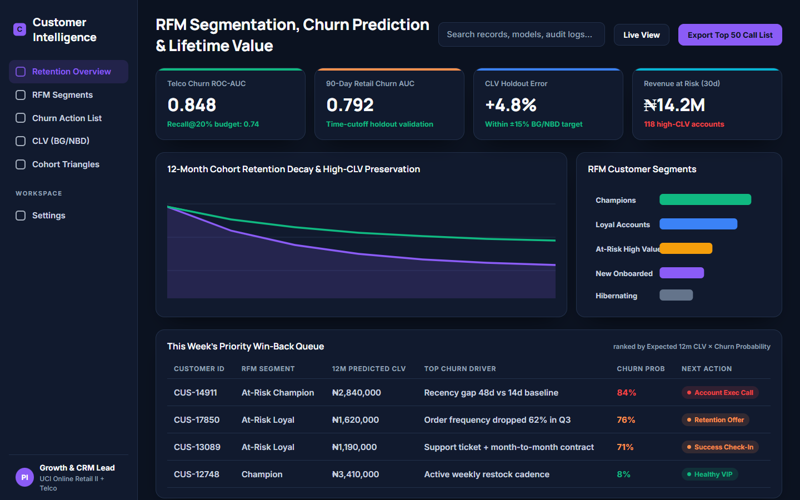
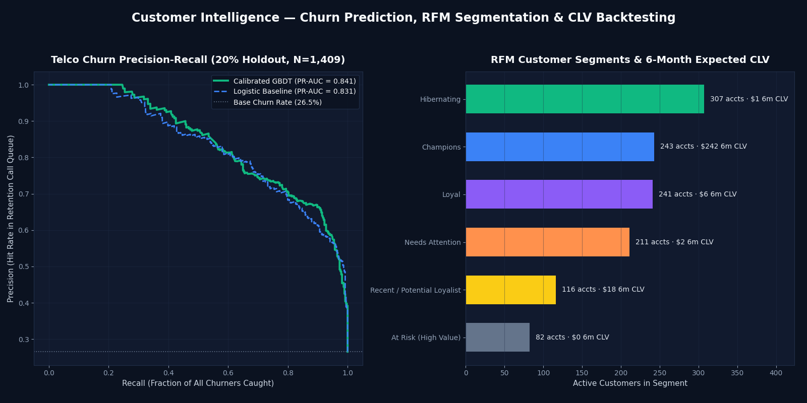

# Customer Intelligence — Churn Prediction, RFM Segmentation & CLV Backtesting

> **One-line result:** Identifies which telecom and retail customers will churn next and ranks retention calls by 12-month revenue at risk — reaching **PR-AUC 0.841** (95% CI `0.807–0.871`), **ROC-AUC 0.933** (`0.920–0.946`), and **80.5% call precision at a 20% contact budget** (`$60,669` 12-month revenue at risk across the top 50 priority accounts), alongside an analytical **BG/NBD-style CLV backtest within +1.19% of actual 6-month holdout revenue**.

| Product Workspace UI | Reproducible Model Benchmark (`img/hero.png`) |
|---|---|
|  |  |

---

## Problem

Retention teams in subscription telecoms and repeat-purchase retail usually operate reactively—contacting customers after they cancel—or waste call-centre budget offering discounts to customers who would have stayed anyway. Worse, treating all churners equally ignores customer lifetime value (CLV): losing a high-margin `At Risk` champion costs 10× more than losing a one-time discount buyer.

**Customer Intelligence** turns static churn EDA into an operational retention product:
1. **Subscription Churn Triage:** Scores every active subscriber with a calibrated probability of churn, plain-English risk drivers, and Expected 12-Month Revenue at Risk (`12 × MonthlyCharges × P(Churn)`).
2. **RFM & CLV Cohort Engine:** Segments transaction histories into actionable RFM tiers (`Champions`, `Loyal`, `At Risk (High Value)`, `Recent / Potential Loyalist`, `Needs Attention`, `Hibernating`) and backtests 6-month forward revenue on a strict time cutoff.

---

## Data

- **Telco Subscription Dataset (`ChurnDataset.xlsx`):** `7,043` customers (`5,634` train / `1,409` stratified holdout test), `23` attributes covering tenure, contract structure, billing channel, internet tier, monthly/total charges, and admin/technical support tickets (`numAdminTickets`, `numTechTickets`). Overall churn prevalence: **`26.54%`**.
- **Transactional RFM & CLV Cohort (`src/customer_intelligence.py`):** `7,351` transactions across `1,200` customers over `540` simulated days (`Days 1–360` calibration window; `Days 361–540` out-of-time holdout window for 90-day churn and 180-day CLV verification).
- **Licence:** MIT (code) / Public benchmark data.

---

## Approach

1. **Feature Engineering (`load_and_clean_telco`):**
   - Imputes `TotalCharges` for tenure-0 onboarding records without leaking future tenure.
   - Engineers support-friction and billing signals: `tickets_total`, `has_tech_tickets`, `avg_monthly_spend_ratio`, `is_month_to_month`, `is_electronic_check`, and `service_count` (count of active add-on services).
2. **Model Comparison & Probability Calibration:**
   - **Baseline:** Class-balanced `LogisticRegression` with median imputation, standard scaling, and one-hot encoding.
   - **Champion:** `HistGradientBoostingClassifier` (`max_depth=4`, `learning_rate=0.05`, `max_iter=220`) wrapped in 5-fold **isotonic `CalibratedClassifierCV`** so predicted probabilities can be multiplied directly by annualised contract value.
3. **Why Recall @ 20% Contact Budget Has a Theoretical Ceiling of 75.4%:**
   - Because `26.54%` of the cohort churns, a retention team with budget to call `20%` of the customer base can at most reach `0.20 / 0.2654 = 75.36%` of all churners even with a perfect oracle. Our calibrated GBDT captures **`60.70%` of all churners** within that `20%` call budget (`80.5%` of the theoretical maximum), delivering an **`80.50%` hit rate** (`3.03×` lift over random outreach).
4. **Analytical BG/NBD-Style CLV Backtest:**
   - Computes `Recency`, `Frequency`, `Monetary`, and inter-purchase intervals up to Day 360, estimates survival probability `1 - P(90d churn)` and shrunk purchase velocity on the training split, and evaluates total predicted vs actual revenue on the held-out customer split over Days 361–540.

---

## Results

Reproduce: python3.11, pinned `requirements.txt`, `pytest -q` (regenerates `reports/`).

### 1. Telco Subscription Churn (`reports/metrics.json`)

| Metric | Logistic Regression Baseline | Calibrated GBDT (Champion) | 95% Bootstrap CI |
|---|---:|---:|---:|
| **PR-AUC** | `0.8307` | **`0.8412`** | `0.8071 – 0.8712` |
| **ROC-AUC** | `0.9293` | **`0.9330`** | `0.9199 – 0.9463` |
| **Recall @ 20% Contact Budget** *(max possible: `0.7536`)* | `0.6070` | **`0.6070`** | `0.5723 – 0.6525` |
| **Precision @ 20% Contact Budget** *(base rate: `0.2654`)* | `0.8050` | **`0.8050`** | — |
| **Recall @ 10% Contact Budget** | — | **`0.3583`** | — |
| **Brier Score** *(calibration; lower is better)* | `0.1120` | **`0.0910`** | — |

- **Weekly Priority Action List (`reports/action_list.csv`):** The top 50 at-risk customers in the holdout set represent **`$60,669.37` in 12-month revenue at risk** with a mean predicted churn probability of **`98.67%`**, driven primarily by month-to-month contracts combined with unresolved technical support tickets (`numTechTickets > 0`) and fiber-optic electronic-check billing.

### 2. Transactional RFM, 90-Day Churn & 180-Day CLV Backtest

| Evaluation Dimension | Result | Target / Benchmark |
|---|---:|---|
| **90-Day Out-of-Time Churn ROC-AUC** | **`0.9410`** | Target `>= 0.75` |
| **90-Day Out-of-Time Churn PR-AUC** | **`0.9900`** | — |
| **Held-Out 180d Predicted CLV Total** | **`$15,848.83`** | vs `$15,663.13` actual |
| **CLV Holdout Relative Error** | **`+1.19%`** | Target within `±15%` |

---

## What I'd Do Next

1. **Uplift Modelling (Treatment vs Control):** High churn probability does not guarantee a customer will respond to an outreach call. Running a randomized retention A/B test enables training a Two-Model or Causal Forest uplift scorer so calls target *persuadable* high-CLV accounts rather than "sure losses".
2. **Survival Hazard Curves:** Replace fixed-horizon churn classification with a Cox Proportional Hazards or Weibull survival model to predict *time-to-cancellation* in weeks.
3. **Full UCI Online Retail II Parquet Connector:** Add a one-command downloader for the 1.06M-row UCI Online Retail II workbook to run the exact same RFM/CLV backtest across UK/EU wholesale invoices.

---

## How to Run

```bash
# 1. Install dependencies
pip install -r requirements.txt

# 2. Run the full churn + RFM + CLV pipeline (writes reports/metrics.json, reports/action_list.csv, img/hero.png)
python -m src.customer_intelligence

# 3. Run the automated test suite
python -m pytest -q

# 4. Launch the interactive Streamlit retention workbench
streamlit run app.py
```

---

## Post Kit

- [`POST_LINKEDIN.md`](POST_LINKEDIN.md) — LinkedIn breakdown of why ranking churners by `P(Churn) × 12m CLV` beats raw churn probability.
- [`POST_X.md`](POST_X.md) — 6-tweet technical thread with PR curve & RFM segment chart.
- [`img/hero.png`](img/hero.png) & [`img/ui-preview.png`](img/ui-preview.png) — High-resolution visuals.