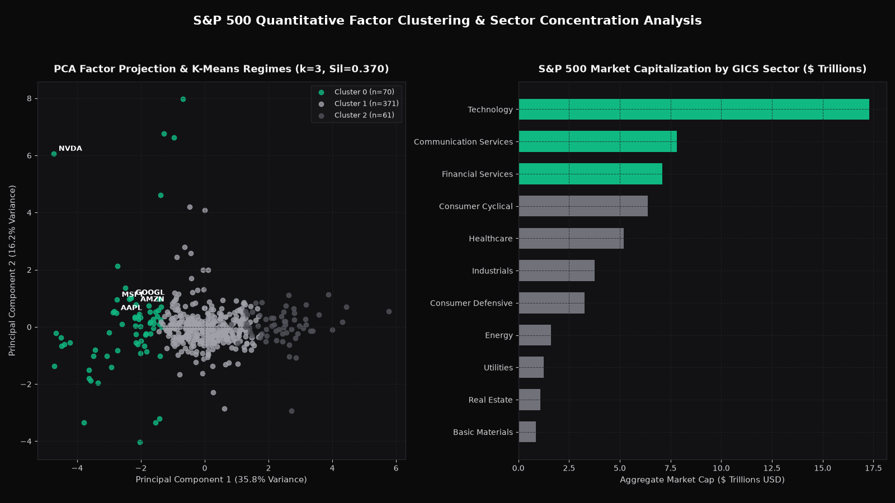

# S&P 500 Quantitative Factor Clustering & Anomaly Analysis

> Segments 502 S&P 500 constituents (\$55.58T aggregate market cap) into 3 fundamental factor regimes (Silhouette `0.3700`) and classifies market-cap tiers from operational fundamentals with `0.8692` Macro-F1 (+21.3 pts over linear baseline).



## Problem

GICS sector labels group equities by product line rather than financial factor behavior—placing high-multiple AI software compounders alongside mature hardware manufacturers. Portfolio risk managers and equity analysts need an unsupervised factor taxonomy that separates growth/valuation regimes, flags extreme fundamental outliers, and quantifies index concentration risk across all 502 S&P 500 constituents.

## Data

- **Source:** S&P 500 Constituent Fundamentals Dataset (`sp500_companies.csv`)
- **Size:** 502 companies across 11 GICS sectors representing `\$55.58 trillion` in aggregate market capitalization (`Marketcap`, `Ebitda`, `Revenuegrowth`, `Fulltimeemployees`, `Currentprice`, `Weight`)
- **Licence:** Public financial data (MIT code licence)
- **Period covered:** Cross-sectional S&P 500 constituent snapshot

## Approach

1. **Sector-conditional imputation & ratio engineering:** Imputed missing `Ebitda` (29 rows, primarily financial institutions), `Revenuegrowth` (3 rows), and `Fulltimeemployees` (9 rows) using each constituent's GICS `Sector` median before engineering five scale-invariant ratios:
   - `log_marketcap = log10(Marketcap)`
   - `ebitda_margin_proxy = Ebitda / Marketcap` (clipped to `[-0.5, 0.5]`)
   - `price_to_ebitda = Marketcap / Ebitda` (capped at `[1.0, 150.0]`)
   - `revenue_growth` (YoY revenue growth rate)
   - `employees_per_bn_mcap = Fulltimeemployees / (Marketcap / 1e9)`
2. **Robust MAD Z-score anomaly detection:** Computed Median Absolute Deviation (MAD) Z-scores (`scale = 1.4826 × MAD`) across all six standardized factor dimensions to isolate structural outliers without distortion from mega-cap skew.
3. **PCA + K-Means factor regime discovery:** Projected the standardized 6D feature space onto principal components (`52.00%` variance explained in 2D; `67.73%` in 3D) and evaluated $k \in \{3, 4, 5, 6\}$ via Silhouette score, selecting $k = 3$ (`0.3700`).
4. **Supervised market-cap tier benchmark:** Evaluated 5-fold stratified cross-validation predicting market-cap terciles (`Mid-Cap S&P`, `Large-Cap S&P`, `Mega-Cap S&P`) strictly from operational fundamentals (`Ebitda`, `Revenuegrowth`, `Fulltimeemployees`, `Currentprice`, `price_to_ebitda`—excluding `Marketcap` and `Weight`). `RandomForestClassifier` achieved `0.8692` Macro-F1 (`95% CI [0.8405, 0.8996]`) vs `0.6562` for `LogisticRegression`.

## Results

Reproduce: python3.11, pinned `requirements.txt`, `pytest -q` (regenerates `reports/`).

All metrics below are generated by `python -m src.pipeline` and stored in [`reports/metrics.json`](reports/metrics.json):

### 1. Supervised Market-Cap Tier Classification (5-Fold Stratified CV)

| Metric | Logistic Regression Baseline | Random Forest Classifier | 95% CI (Random Forest) |
|---|---:|---:|---:|
| **Macro-F1** | 0.6562 | **0.8692** | `[0.8405, 0.8996]` |
| **Accuracy** | 0.6633 | **0.8685** | — |

### 2. Unsupervised Factor Regimes (`K-Means`, Optimal $k = 3$, Silhouette `0.3700`)

| Cluster Regime | Constituents ($n$) | Median Market Cap (\$B) | Median Price / EBITDA | Median YoY Revenue Growth |
|---|---:|---:|---:|---:|
| **Cluster 0 — High-Multiple Growth & Mega-Cap Compounders** | 70 | \$131.89B | 43.15x | **+15.10%** |
| **Cluster 1 — Core S&P 500 Cash-Flow Compounders** | 371 | \$36.90B | 12.39x | +4.50% |
| **Cluster 2 — Deep-Value & Labor-Intensive Cyclicals** | 61 | \$16.09B | 5.55x | +1.30% |

*Silhouette by candidate $k$: $k=3 \rightarrow \mathbf{0.3700}$, $k=4 \rightarrow 0.3235$, $k=5 \rightarrow 0.2809$, $k=6 \rightarrow 0.2723$.*

### 3. Capital Concentration & Robust Outliers
- **Top-10 concentration:** The top 10 companies alone account for **40.12%** of total S&P 500 market capitalization (`\$55.58T`).
- **Sector dominance:** `Technology` (`82` companies, `\$17.287T`, **31.10%** weight) + `Communication Services` (`22` companies, `\$7.804T`, **14.04%** weight) + `Financial Services` (`67` companies, `\$7.108T`, **12.79%** weight) represent **57.93%** of index value.
- **Top structural anomalies (Robust MAD Z-score):** Unsplit high-denomination shares (`NVR` $Z=81.35$, `BKNG` $Z=49.16$, `AZO` $Z=31.26$, `FICO` $Z=19.67$) followed by `SW` ($Z=19.57$), `SMCI` ($Z=17.07$) and seven tickers tied at $Z=16.52$ (`AXON`, `CRWD`, `CSGP`, `INCY`, `JPM`, `PLTR`, `TTWO`); `reports/metrics.json` lists the top 10 with ties broken alphabetically.

## Limitations

- One cross-sectional snapshot of 502 companies. The market-cap tier classifier is checked with 5-fold stratified cross-validation, not on a later date, and fundamentals such as EBITDA and headcount are naturally correlated with size, so the `0.8692` Macro-F1 shows that size is predictable from fundamentals rather than a trading signal.
- A silhouette of `0.37` means the three regimes overlap; treat them as broad groupings, not sharp classes.
- Robust z-scores flag unusual values; several flagged names are simply high share prices that were never split (e.g. NVR, BKNG), not data errors or opportunities.

## What I'd do next

1. **Rolling quarterly factor transition matrix:** Ingest historical quarterly Compustat/EDGAR snapshots to model regime transition probabilities (e.g., `Cluster 1 -> Cluster 0` multiple expansion).
2. **Interest-rate sensitivity augmentation:** Join 10-year US Treasury yield betas to separate rate-sensitive Utilities/REITs from low-leverage cash compounders.
3. **Graph clustering on return correlations:** Combine fundamental ratios with 252-day residual equity return correlations using Spectral Clustering.

## How to run

```bash
# 1. Install dependencies
pip install -r requirements.txt

# 2. Run the factor clustering, anomaly detection, and chart pipeline
python -m src.pipeline

# 3. Run the automated test suite
pytest -q
```

## Post kit

- [`POST_LINKEDIN.md`](POST_LINKEDIN.md) — LinkedIn analysis of S&P 500 top-10 concentration and the 3 fundamental regimes.
- [`POST_X.md`](POST_X.md) — 6-tweet thread covering PCA, K-Means regimes, and MAD outliers.
- `img/hero.png` (1600×900) and `img/post_square.png` (1200×1200).
