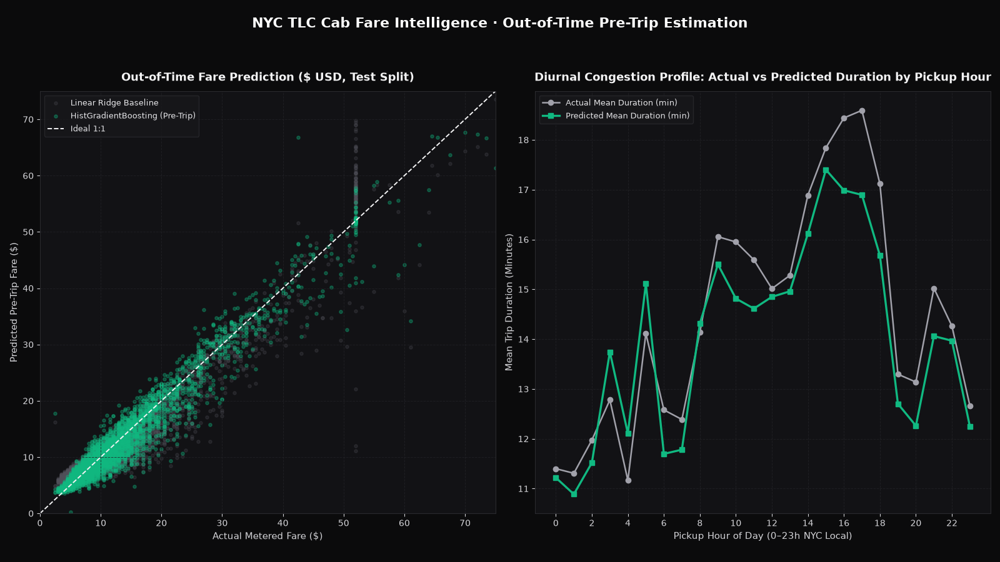

# NYC TLC Cab Fare & Duration Intelligence

> Predicts NYC Yellow Taxi metered fares from pre-trip fields plus trip distance (see Limitations): MAE \$1.47 ($R^2 = 0.9499$, 29.6% lower error than linear baseline) on an out-of-time test split of 4,489 trips.



## Problem

Ride-hailing and taxi dispatch platforms must quote upfront fares and arrival estimates at the moment a rider requests a trip—before the meter runs, tolls accrue, or traffic delays materialize. Naive models that include post-trip fields (`total_amount`, `tip_amount`, or `tpep_dropoff_datetime`) suffer from severe target leakage and fail in production. This pipeline predicts both metered `fare_amount` (\$ USD) and `trip_duration_min` (minutes) using strictly pre-dispatch attributes evaluated on a chronological out-of-time split.

## Data

- **Source:** NYC Taxi & Limousine Commission (TLC) 2017 Yellow Taxi Trip Records (`2017_Yellow_Taxi_Trip_Data.csv`)
- **Size:** 22,699 raw trips; 22,441 clean trips after removing 20 non-positive fare records (`fare_amount <= 0`), 148 zero-distance records (`trip_distance <= 0`), and extreme meter/duration outliers
- **Licence:** NYC Open Data Public Domain (MIT code licence)
- **Period covered:** Full calendar year 2017 (`2017-01-01` to `2017-12-31`), split chronologically at `2017-10-19 19:02:16` into 17,952 training trips (Jan–Oct) and 4,489 out-of-time test trips (Oct–Dec)

## Approach

1. **Strict pre-trip feature firewall (zero leakage):** Explicitly banned all post-trip settlement and timestamp columns (`total_amount`, `tip_amount`, `tolls_amount`, `extra`, `mta_tax`, `improvement_surcharge`, `payment_type`, and `tpep_dropoff_datetime`). Only nine pre-dispatch features enter the model: `trip_distance`, `pickup_hour`, `pickup_dayofweek`, `is_weekend`, `is_rush_hour`, `RatecodeID`, `PULocationID`, `DOLocationID`, and `passenger_count`.
2. **Chronological out-of-time validation:** Sorted all 22,441 clean trips by `tpep_pickup_datetime` and trained on the first 80% (`Jan 1 – Oct 19, 2017`), testing on the final 20% (`Oct 19 – Dec 31, 2017`, covering Q4 holiday congestion).
3. **Model comparison:** Benchmarked a `StandardScaler + Ridge` linear model against `HistGradientBoostingRegressor` for both metered fare (`fare_amount`) and trip duration (`trip_duration_min`), with 500-iteration bootstrap 95% confidence intervals.
4. **Why Gradient Boosting wins:** While distance is roughly linear with base fare, NYC TLC airport flat rates (`RatecodeID = 2` JFK \$52 flat fare) and rush-hour Manhattan congestion create sharp non-linear interactions between `RatecodeID`, `PULocationID`, `DOLocationID`, and `pickup_hour`. `HistGradientBoostingRegressor` captures these regime shifts, cutting Fare MAE from `\$2.09` to `\$1.47` (`-29.6%`) and Duration MAE from `5.01 min` to `3.64 min` (`-27.4%`).

## Results

Reproduce: python3.11, pinned `requirements.txt`, `pytest -q` (regenerates `reports/`).

All metrics are computed on the chronological out-of-time test split (`n = 4,489`, mean fare `\$12.91`, median fare `\$9.50`, mean duration `14.45 min`) from [`reports/metrics.json`](reports/metrics.json):

### 1. Pre-Trip Metered Fare Estimation (`fare_amount`, \$ USD)

| Metric | Linear Ridge Baseline | HistGradientBoosting | 95% CI (HistGB) |
|---|---:|---:|---:|
| **MAE (\$ USD)** | \$2.0946 | **\$1.4739** | `[$1.4178, $1.5356]` |
| **RMSE (\$ USD)** | \$3.3054 | **\$2.4279** | `[$2.2307, $2.6341]` |
| **$R^2$** | 0.9071 | **0.9499** | `[0.9431, 0.9563]` |
| **Quotes within ±\$1.00** | 33.21% | **53.22%** | — |
| **Quotes within ±\$2.00** | — | **77.23%** | — |

### 2. Pre-Trip Duration Estimation (`trip_duration_min`, Minutes)

| Metric | Linear Ridge Baseline | HistGradientBoosting | 95% CI (HistGB) |
|---|---:|---:|---:|
| **MAE (Minutes)** | 5.0125 | **3.6377** | `[3.5092, 3.7778]` |
| **RMSE (Minutes)** | 7.4940 | **5.8181** | `[5.4342, 6.1929]` |
| **$R^2$** | 0.6395 | **0.7827** | `[0.7641, 0.8004]` |

## Limitations

- `trip_distance` is the distance the meter recorded at the end of the trip. A real upfront quote would use a routed estimate, which is noisier, so the errors here are a lower bound on what a live quoting system would see.
- The data is a 22,699-trip sample of 2017 trips, and the test window (19 Oct–31 Dec) is one season. No check across years or fare-rule changes.

## What I'd do next

1. **Origin-Destination target encoding with smoothing:** Replace raw integer `PULocationID` and `DOLocationID` with out-of-fold historical corridor speed (mph) and median fare per mile across the 263 NYC taxi zones.
2. **Weather & holiday calendar join:** Join NOAA Central Park hourly precipitation and NYC street-closure calendars to reduce Q4 afternoon rush-hour duration variance.
3. **Quantile regression for guaranteed upfront pricing:** Train 50th and 85th percentile pinball-loss models (`loss="quantile"`) so dispatchers can price fixed upfront quotes with bounded margin risk.

## How to run

```bash
# 1. Install dependencies
pip install -r requirements.txt

# 2. Run the chronological training, evaluation, and chart pipeline
python -m src.pipeline

# 3. Run the automated leakage and metric test suite
pytest -q
```

## Post kit

- [`POST_LINKEDIN.md`](POST_LINKEDIN.md) — LinkedIn case study on preventing post-trip leakage in upfront fare quoting.
- [`POST_X.md`](POST_X.md) — 6-tweet thread detailing chronological split results and diurnal congestion.
- `img/hero.png` (1600×900) and `img/post_square.png` (1200×1200).
