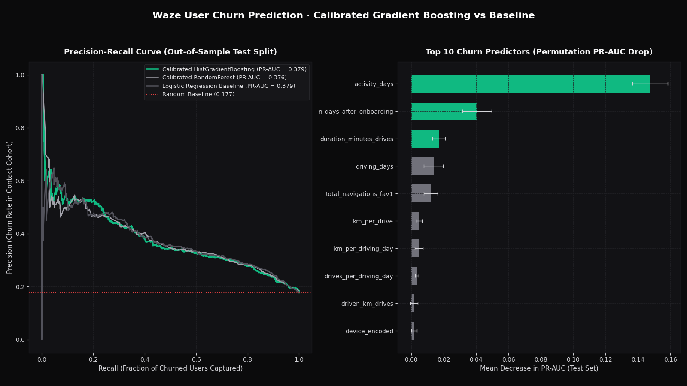

# Waze User Churn Prediction

> Predicts monthly user churn on 14,299 Waze navigators: PR-AUC 0.3785 (2.13x lift over the 17.73% base rate) and 43.00% churn recall at a 20% retention contact budget.



## Problem

Monthly retention campaigns on mobile navigation apps face strict notification budgets: sending re-engagement push alerts to the entire user base triggers app uninstalls, while untargeted sampling misses high-mileage commuters at risk of switching. This pipeline ranks active Waze users by calibrated 30-day churn probability so lifecycle marketing teams can concentrate retention incentives on the top 10%–20% highest-risk cohort.

## Data

- **Source:** Waze User Telemetry Dataset (`waze_dataset.csv`, Google Advanced Data Analytics / Waze case study)
- **Size:** 14,999 total user records across 13 telemetry attributes; 14,299 labeled records after dropping 700 rows with missing `label` (11,439 train / 2,860 stratified test)
- **Licence:** Public educational dataset (MIT / portfolio code licence)
- **Period covered:** Cross-sectional monthly behavioral telemetry window plus onboarding tenure (`n_days_after_onboarding`)

## Approach

1. **Leakage-free cleaning & target definition:** Dropped 700 unlabeled records (`label.isna()`) rather than imputing the target, and excluded the row identifier (`ID`) from modeling features. Overall churn base rate is `17.74%` (`17.73%` on the stratified 20% test split).
2. **Behavioral feature engineering:** Engineered four domain ratios to capture intensity versus habit frequency:
   - `km_per_drive = driven_km_drives / drives`
   - `km_per_driving_day = driven_km_drives / driving_days`
   - `drives_per_driving_day = drives / driving_days`
   - `pct_sessions_fav = (total_navigations_fav1 + total_navigations_fav2) / total_sessions`
   - `device_encoded` (`iPhone = 1`, `Android = 0`)
3. **Model comparison & probability calibration:** Compared a `StandardScaler + LogisticRegression` baseline against 5-fold isotonic-calibrated `RandomForestClassifier` and `HistGradientBoostingClassifier` pipelines. Evaluated ranking and calibration using 500-iteration bootstrap 95% confidence intervals on the held-out test split (`n = 2,860`).
4. **Why linear and tree models converge here:** Permutation importance reveals that two monotonic features—`activity_days` (`0.1450 ± 0.0110` PR-AUC drop) and `n_days_after_onboarding` (`0.0398 ± 0.0090` PR-AUC drop)—dominate the signal. Because log-odds of churn decay nearly linearly with active days (`median 6.0` driving days for churned users vs `14.0` for retained users), `Calibrated HistGradientBoosting` (`PR-AUC 0.3755`) and `Logistic Regression` (`PR-AUC 0.3785`) achieve virtually identical discrimination (the 95% intervals overlap almost entirely), and the Logistic Regression baseline is at least as good on every reported metric, including top-decile recall (`26.82%` vs `25.44%`).

## Results

Reproduce: python3.11, pinned `requirements.txt`, `pytest -q` (regenerates `reports/`).

All metrics below are computed on the held-out 20% stratified test split (`n = 2,860`, base churn rate `0.1773`) and verified against [`reports/metrics.json`](reports/metrics.json):

| Metric | Logistic Regression Baseline | Calibrated Random Forest | Calibrated HistGradientBoosting | 95% CI (HistGB) |
|---|---:|---:|---:|---:|
| **PR-AUC** | **0.3785** | 0.3757 | 0.3755 | `[0.3346, 0.4169]` |
| **ROC-AUC** | **0.7447** | 0.7402 | 0.7363 | `[0.7139, 0.7595]` |
| **Brier Score** (lower is better) | **0.1291** | 0.1297 | 0.1299 | `[0.1216, 0.1381]` |
| **Recall @ 10% Contact Rate** | **0.2682** | 0.2623 | 0.2544 | `[0.2271, 0.2889]` |
| **Recall @ 20% Contact Rate** | **0.4300** | 0.4221 | 0.4280 | `[0.3897, 0.4639]` |
| **Precision @ 10% Contact Rate** | **0.4755** | 0.4650 | 0.4510 | `[0.3951, 0.5210]` |
| **Precision @ 20% Contact Rate** | **0.3811** | 0.3741 | 0.3794 | `[0.3357, 0.4196]` |

### Key Behavioral Cohort Insights
- **Hyper-marathoner churn paradox:** Churned users drive **59.2% more kilometers per driving day** (`median 407.60 km/day`) than retained users (`median 256.06 km/day`), indicating that long-haul/irregular drivers churn at much higher rates than daily urban commuters (`median 14.0` driving days vs `6.0` for churned users).
- **Onboarding tenure gap:** Churned users have a median tenure of `1,321 days` vs `1,843 days` for retained users.
- **OS parity:** Churn rates are virtually identical across platforms (`17.83%` on iPhone vs `17.56%` on Android), confirming that retention defects are behavioral rather than OS-specific.

## Limitations

- The test split is a stratified random 20% holdout. The dataset is one month of telemetry with no event dates, so there is no out-of-time test.
- Discrimination is modest (PR-AUC `0.3785`, ROC-AUC `0.7447`): useful for ranking a contact list, weak for individual decisions. Gradient boosting and random forest did not beat the logistic baseline.
- The main drivers (`activity_days`, `n_days_after_onboarding`) describe the same month as the label, so they flag users already disengaging rather than predicting churn far ahead.

## What I'd do next

1. **Longitudinal week-over-week velocity features:** Replace single-month aggregates with weekly deltas ($\Delta \text{driving\_days}_{t - (t-1)}$) to detect sudden engagement drop-offs before a user hits zero monthly sessions.
2. **Segment-specific uplift modeling:** Separate long-haul intercity drivers (`>300 km/driving day`) from daily commuters and run a randomized holdout test to measure incremental retention lift per push notification.
3. **Cost-sensitive threshold optimization:** Incorporate customer lifetime value (ad impressions per navigated kilometer) into the expected-value contact threshold.

## How to run

```bash
# 1. Install dependencies
pip install -r requirements.txt

# 2. Run the training, evaluation, and chart generation pipeline
python -m src.pipeline

# 3. Run the automated test suite
pytest -q
```

## Post kit

- [`POST_LINKEDIN.md`](POST_LINKEDIN.md) — LinkedIn breakdown of the long-haul vs daily commuter churn paradox.
- [`POST_X.md`](POST_X.md) — 6-tweet technical thread with metrics and charts.
- `img/hero.png` (1600×900) and `img/post_square.png` (1200×1200).
