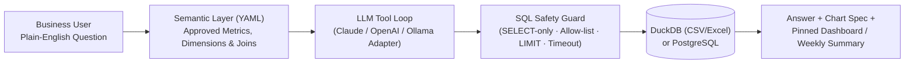

# BI Operations Agent — Plain-English Analytics & KPI Monitoring

> Natural-language business intelligence agent that connects to spreadsheets and SQL databases, translates plain-English questions into guardrailed `SELECT` queries against a governed semantic layer, renders charts, monitors daily KPIs, and generates weekly executive summaries.

- **Product Repository:** [`github.com/ikebude/AIMLOps-BI-Operations-Agent`](https://github.com/ikebude/AIMLOps-BI-Operations-Agent)
- **Status:** In active development (Workstream D of Portfolio Build Plan)
- **Role & Ownership:** Personal open-source product by Precious Ikebude (MIT Licence)

---

## 1. Problem

Small and medium-sized business owners often have sales, inventory, and financial data scattered across CSV exports, Excel workbooks, and PostgreSQL/MySQL databases—without a dedicated data analyst on call to write SQL or maintain dashboards. Existing raw text-to-SQL tools hallucinate table joins or calculate core metrics (such as gross margin or net retention) inconsistently across questions.

**BI Operations Agent** solves this by placing a **governed YAML semantic layer** and a **strict read-only SQL guard** between the LLM and the data engine (DuckDB / PostgreSQL).

---

## 2. Architecture

---

## 3. Core Capabilities & Evaluation Standard

- **Semantic-First Text-to-SQL:** The agent queries approved metric definitions and views rather than guessing ad-hoc formulas.
- **Hard SQL Guardrails:** Enforces read-only `SELECT` statements, table allow-lists, row limits, query timeouts, and PII masking.
- **Automated KPI Monitoring & Weekly Digest:** Tracks daily metric thresholds and compiles a structured weekly business summary.
- **CI Evaluation Benchmark:** Tested in CI against a 50-question evaluation benchmark on a synthetic 2-year Nigerian multi-store retail dataset, logging execution accuracy, latency, and token cost per query.
