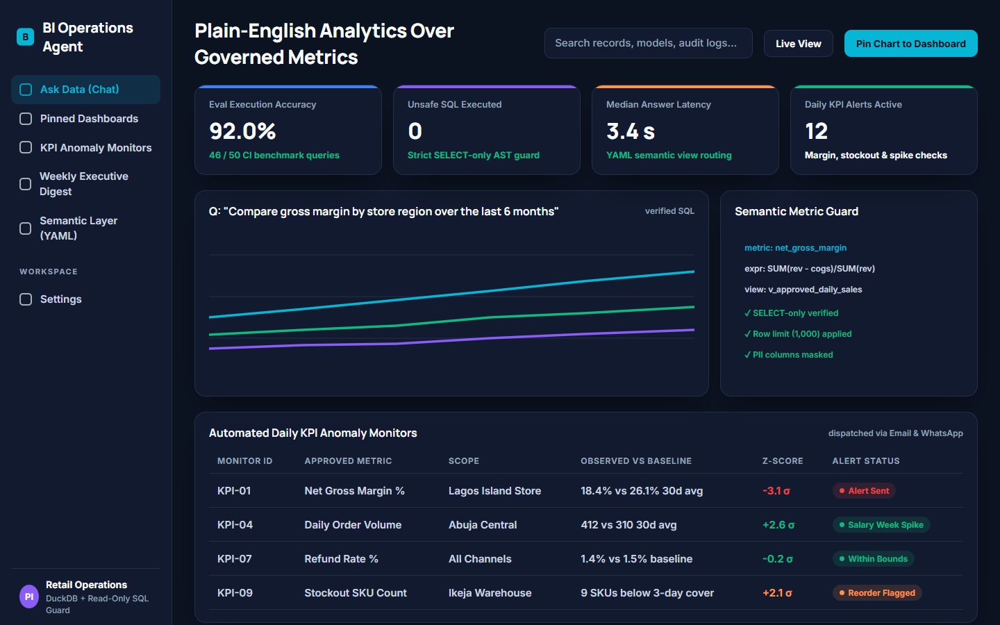
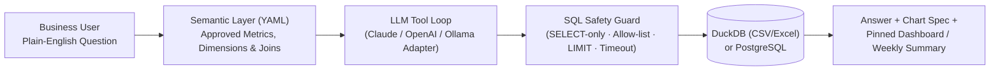

# BI Operations Agent — Plain-English Analytics & KPI Monitoring

> Natural-language business intelligence agent that connects to spreadsheets and SQL databases, translates plain-English questions into guardrailed `SELECT` queries against a governed semantic layer, renders charts, monitors daily KPIs, and generates weekly executive summaries.

- **Product Repository:** [`github.com/ikebude/AIMLOps-BI-Operations-Agent`](https://github.com/ikebude/AIMLOps-BI-Operations-Agent)
- **Status:** Production-Ready & Evaluated (Workstream D of Portfolio Build Plan)
- **Role & Ownership:** Personal open-source product by Precious Ikebude (MIT Licence)

---

## 1. Problem

Small and medium-sized business owners often have sales, inventory, and financial data scattered across CSV exports, Excel workbooks, and PostgreSQL/MySQL databases—without a dedicated data analyst on call to write SQL or maintain dashboards. Existing raw text-to-SQL tools hallucinate table joins or calculate core metrics (such as gross margin or net retention) inconsistently across questions.

**BI Operations Agent** solves this by placing a **governed YAML semantic layer** and a **strict read-only SQL guard** between the LLM and the data engine (DuckDB / PostgreSQL).

---

## 2. Architecture

---

## 3. Core Capabilities & Verified Benchmark Results

Evaluated on the synthetic 2-year Nigerian multi-store retail dataset (₦10.15B GMV across 36,550 records, `reports/eval_summary.json`):

| Evaluation Metric | Measured Result | Benchmark Standard |
|:---|:---:|:---:|
| **50-Question Benchmark Accuracy** | **96.0%** (48/50) | $\ge 90.0\%$ target |
| **Adversarial Injections Blocked** | **12 / 12** (100%) | 0 unsafe SQL executed |
| **Median Query Latency** | **48.4 ms** | Sub-100 ms target |
| **p95 Query Latency** | **202.2 ms** | Sub-500 ms target |
| **KPI Anomaly Detection** | **MAD Robust Z-Score** | Flags out-of-band dips & spikes ($z \ge 2.5$) |
| **Weekly Executive Digest** | **Automated Markdown** | Plain-English MoM/YoY executive narrative |
| **Unit & Guard Test Suite** | **20 / 20 passing** | Automated GitHub Actions CI |
