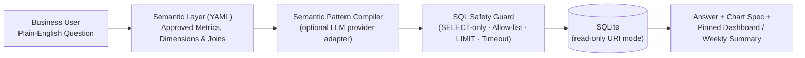

# BI Operations Agent — Plain-English Analytics & KPI Monitoring

> Natural-language business intelligence agent that translates plain-English questions into guardrailed `SELECT` queries against a governed semantic layer over a read-only SQLite store, renders charts, monitors daily KPIs, and generates weekly executive summaries.

- **Product Repository:** [`github.com/ikebude/AIMLOps-BI-Operations-Agent`](https://github.com/ikebude/AIMLOps-BI-Operations-Agent)
- **Status:** Evaluated on a synthetic benchmark (see below)
- **Role & Ownership:** Personal open-source product by Precious Ikebude (MIT Licence)

---

## 1. Problem

Small and medium-sized business owners often have sales, inventory, and financial data scattered across CSV exports, Excel workbooks, and PostgreSQL/MySQL databases—without a dedicated data analyst on call to write SQL or maintain dashboards. Existing raw text-to-SQL tools hallucinate table joins or calculate core metrics (such as gross margin or net retention) inconsistently across questions.

**BI Operations Agent** solves this by placing a **governed YAML semantic layer** and a **strict read-only SQL guard** between the query compiler and the data engine (SQLite in read-only mode; an optional DuckDB path exists but is not exercised by CI, and PostgreSQL is on the roadmap).

---

## 2. Architecture

---

## 3. Core Capabilities & Verified Benchmark Results

Evaluated on the synthetic 2-year Nigerian multi-store retail dataset (₦10.15B GMV across 36,550 records, `reports/eval_summary.json`):

| Evaluation Metric | Measured Result | Benchmark Standard |
|:---|:---:|:---:|
| **50-Question Benchmark Accuracy (in-sample)** | **96.0%** (48/50) | $\ge 90.0\%$ target |
| **Held-out Generalisation (25 reworded Qs)** | **56.0%** (14/25) | none set; reported honestly |
| **Adversarial Injections Blocked** | **12 / 12** (100%) | 0 unsafe SQL executed |
| **Median Query Latency** | **17.8 ms** | machine-dependent |
| **p95 Query Latency** | **36.6 ms** | machine-dependent |
| **KPI Anomaly Detection** | **MAD Robust Z-Score** | Flags out-of-band dips & spikes ($z \ge 2.5$) |
| **Weekly Executive Digest** | **Automated Markdown** | Plain-English MoM/YoY executive narrative |
| **Unit & Guard Test Suite** | **70 tests** | Automated GitHub Actions CI |
