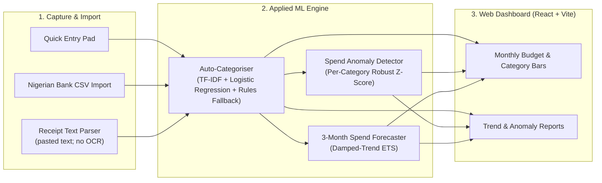

# AIOps Expense Tracker — NGN-First Personal & SME Finance Intelligence

> NGN-first expense tracker (FastAPI ML service + React/Vite dashboard) featuring TF-IDF + Logistic Regression auto-categorisation retrained on user corrections, receipt-text parsing, robust MAD z-score spending anomaly flags, and a 3-month damped-trend ETS spend forecast. All benchmark numbers below are on a **synthetic** 600-row dataset.

- **Product Repository:** [`github.com/ikebude/AIOps_Expense_Tracker`](https://github.com/ikebude/AIOps_Expense_Tracker)
- **Role & Ownership:** Personal open-source project by Precious Ikebude (MIT Licence). *Started from the Code with Mosh Claude Code course starter; rebuilt and extended by me.*

---

## 1. Problem

Most consumer expense apps fail Nigerian individuals and small-business owners because they rely on US/EU open-banking APIs, mishandle NGN bank statement CSV formats (GTBank, Access, OPay, Kuda), and use rigid category rules that never adapt to local merchant names or narration strings.

**AIOps Expense Tracker** combines a React + Vite web dashboard with lightweight, transparent ML models (served by FastAPI) that learn from the user's own transaction corrections.

---

## 2. Architecture & ML Pipeline

---

## 3. Key Features

- **Adaptive Auto-Categorisation:** Uses deterministic keyword rules on cold start and retrains a lightweight TF-IDF + Logistic Regression classifier as the user confirms or corrects categories.
- **Spend Anomaly Detection:** Flags unusual transactions or category spikes using median/MAD robust z-scores rather than brittle static limits.
- **3-Month Forecasting:** Projects monthly spend with a damped-trend ETS model, backtested on a 2-month holdout against a naive last-value baseline (no confidence band is drawn).

---

## 4. Verified Benchmark Metrics

Evaluated on 600 **synthetic** labelled Nigerian personal/SME transactions (generated by `ml/data.py`, seed 42; product repo `reports/metrics.json`). These numbers show the pipeline works, not real-world accuracy:

| Evaluation Metric | Measured Result | Benchmark Standard / Baseline |
|:---|:---:|:---:|
| **Macro-F1 (Holdout 75/25)** | **0.9204** | 95% CI: `[0.8590, 0.9614]` |
| **Accuracy (Holdout)** | **92.67%** | 95% CI: `[0.8800, 0.9667]` |
| **Lift over Keyword Rules** | **+14.03%** | Heuristic rules: `0.7801` Macro-F1 |
| **5-Fold Cross-Validation Macro-F1** | **0.9301 ± 0.0231** | 5-Fold CV Accuracy: `93.00%` |
| **Receipt-Text Field Exact Match** | **97.50%** (195/200) | 40 synthetic receipts; no OCR (text input only) |
| **Bank CSV Import Smoke Test** | **5 / 5 rows** | GTBank, Access, OPay, Kuda (one small sample each) |
| **Anomaly Detection (MAD z-score, $z \ge 2.5$)** | **F1 0.973** (recall 100%, precision 94.7%) | Global z-score baseline F1 `0.6875`; 18 injected spikes, in-sample |
| **Forecast Holdout WAPE** | **8.1%** | Naive last-value baseline: `11.22%` (2-month holdout) |
| **Test Suites** | **32 pytest + 29 vitest passing** | Automated GitHub Actions CI |
