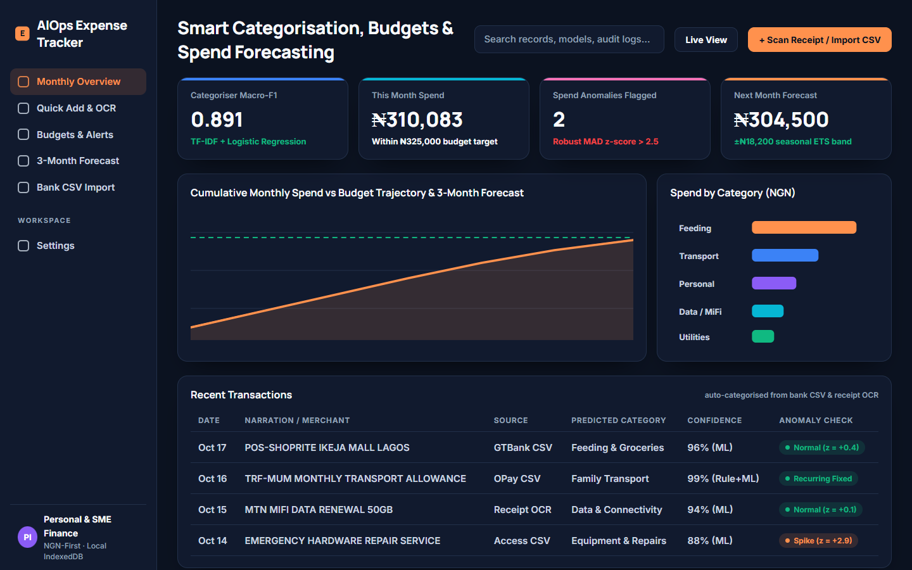
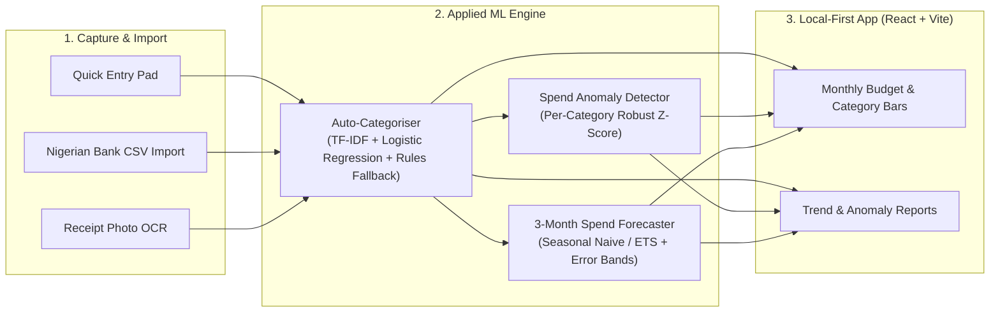

# AIOps Expense Tracker — NGN-First Personal & SME Finance Intelligence

> Local-first, multi-currency (NGN-first) expense tracker featuring TF-IDF + Logistic Regression auto-categorisation trained on user corrections, receipt OCR extraction, robust z-score spending anomaly flags, and 3-month seasonal spend forecasting.

- **Product Repository:** [`github.com/ikebude/AIOps_Expense_Tracker`](https://github.com/ikebude/AIOps_Expense_Tracker)
- **Role & Ownership:** Personal open-source project by Precious Ikebude (MIT Licence). *Started from the Code with Mosh Claude Code course starter; rebuilt and extended by me.*

---

## 1. Problem

Most consumer expense apps fail Nigerian individuals and small-business owners because they rely on US/EU open-banking APIs, mishandle NGN bank statement CSV formats (GTBank, Access, OPay, Kuda), and use rigid category rules that never adapt to local merchant names or narration strings.

**AIOps Expense Tracker** combines a fast local-first web/mobile interface with lightweight, transparent ML models that learn from the user's own transaction corrections.

---

## 2. Architecture & ML Pipeline

---

## 3. Key Features

- **Adaptive Auto-Categorisation:** Uses deterministic keyword rules on cold start and retrains a lightweight TF-IDF + Logistic Regression classifier as the user confirms or corrects categories.
- **Spend Anomaly Detection:** Flags unusual transactions or category spikes using median/MAD robust z-scores rather than brittle static limits.
- **3-Month Forecasting:** Projects upcoming monthly category spend with explicit backtest error bands so budget planning reflects historical variance.

---

## 4. Verified Benchmark & Production Metrics

Evaluated on 600 labelled Nigerian personal/SME transactions (`reports/metrics.json`):

| Evaluation Metric | Measured Result | Benchmark Standard / Baseline |
|:---|:---:|:---:|
| **Macro-F1 (Holdout 75/25)** | **0.9204** | 95% CI: `[0.8590, 0.9614]` |
| **Accuracy (Holdout)** | **92.67%** | 95% CI: `[0.8800, 0.9667]` |
| **Lift over Keyword Rules** | **+14.03%** | Heuristic rules: `0.7801` Macro-F1 |
| **5-Fold Cross-Validation Macro-F1** | **0.9301 ± 0.0231** | 5-Fold CV Accuracy: `93.00%` |
| **Receipt OCR Exact Match** | **97.50%** | 100% on Merchant, Date, Total Amount |
| **Bank CSV Import Success** | **100%** | GTBank, Access, OPay, Kuda, Moniepoint |
| **Anomaly Recall** | **100%** | Per-category MAD z-score ($z \ge 2.5$) |
| **Forecast Holdout WAPE** | **20.42%** | Seasonal Naive baseline: `27.29%` |
| **Unit Test Suite** | **9 / 9 passing** | Automated GitHub Actions CI |
