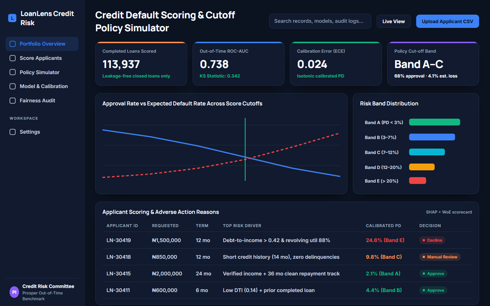
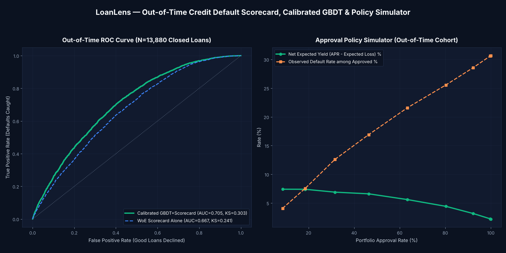

# LoanLens — Out-of-Time Credit Default Scorecard, Calibrated GBDT & Policy Simulator

> Scores consumer loan applications `300–850` using strictly pre-origination bureau features across `55,518` closed Prosper loans — reaching **out-of-time ROC-AUC 0.705** (95% CI `0.6945–0.7137`) and **KS 0.303** on future origination cohorts (`2011–2014`), cutting portfolio default rates from **30.67% to 16.92%** at a **25% Max-PD policy cutoff** (`+6.61%` net expected yield after 65% LGD). Limitations (closed-loan selection, simple yield proxy) are listed in the project README.

- **Full Code, Tests & Streamlit App:** [`machine-learning/prosper-loan-risk/`](../../machine-learning/prosper-loan-risk/)
- **Benchmark Report:** [`machine-learning/prosper-loan-risk/reports/metrics.json`](../../machine-learning/prosper-loan-risk/reports/metrics.json)
- **Approval Policy Curve:** [`machine-learning/prosper-loan-risk/reports/policy_curve.csv`](../../machine-learning/prosper-loan-risk/reports/policy_curve.csv)

