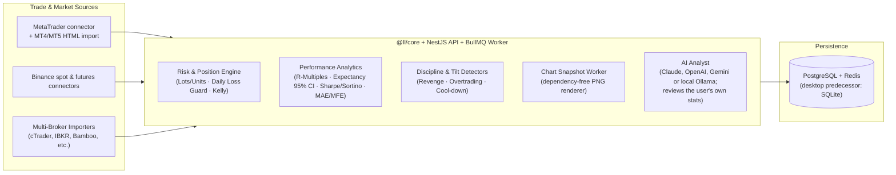

# Lolo's Ledger — Multi-Asset Trading Journal, Risk Engine & AI Performance Coach

> Ports the engine of my local-first desktop trading journal (FXLedger v1.1.0, archived desktop predecessor), with its **349 core tests**, into a full-stack NestJS + React + BullMQ monorepo with position-sizing risk guards, per-trade chart snapshots, a Python research service and an educational AI analyst. Benchmark figures in the product repo come from a **synthetic** 240-trade journal and are not trading results, so none are quoted here.

- **Desktop predecessor (archived):** FXLedger v1.1.0 — repository archived; not linked.
- **Current codebase:** Lolo's Ledger (private repository; this page is the public case study).
- **Role & Ownership:** Personal product built by Precious Ikebude (source private).

---

## 1. Problem

Retail and prop-firm traders across forex, crypto, indices, commodities, and equities lose capital primarily through position-sizing mistakes, breaking daily drawdown rules, and failing to review losing streaks objectively. Most cloud journals require expensive subscriptions, lock user data away, or push "AI trading signals" instead of helping traders measure and enforce their own process.

**Lolo's Ledger** focuses strictly on **risk discipline, quantitative trade attribution, and behavioural review**:
- **Never generates buy/sell signals or price predictions.**
- Enforces position sizing, daily loss limits, and pre-trade checklists before a trade is placed.

---

## 2. Architecture

---

## 3. Verification & Engineering Highlights

- **Tests:** core (including the 349 tests ported from FXLedger v1.1.0), API, web and Python suites, plus Playwright end-to-end tests. The ported core suite covers R-multiple expectancy with 95% confidence intervals, Sharpe/Sortino/Calmar ratios, MAE/MFE excursion tracking, prop-firm daily-loss circuit breakers, and fuzzy-header broker CSV importers.
- **Full-Stack Monorepo (`pnpm` + `Turborepo`):** Shared TypeScript `@ll/core` math/risk package, NestJS REST + webhook API (`services/api`), BullMQ background worker, PostgreSQL + Redis (`docker-compose`), and React + TanStack Router web UI (`apps/web`).
- **Python Research Service:** No-look-ahead backtester with costs and ATR stops, anchored and rolling walk-forward with out-of-sample scoring, and a personal-edge model that refuses to fit below 100 closed trades.
- **Model-Gated AI:** The AI analyst can run fully offline through Ollama. Every number it writes is checked against its input, otherwise a built-in template is shown, and it never gives buy/sell signals (`"Educational, not financial advice"`). Screenshot OCR is specified but not built yet.
