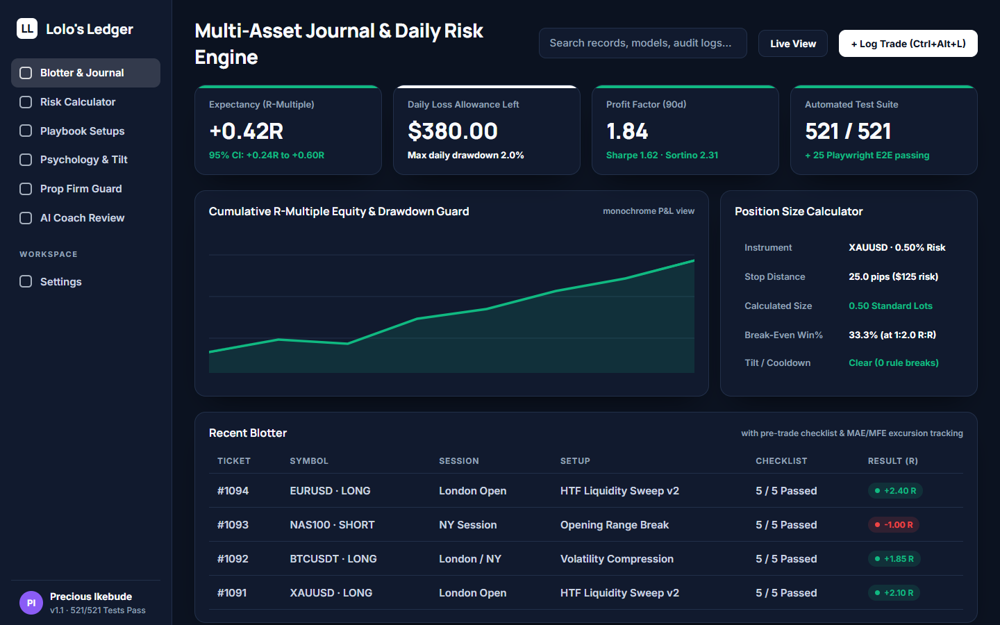
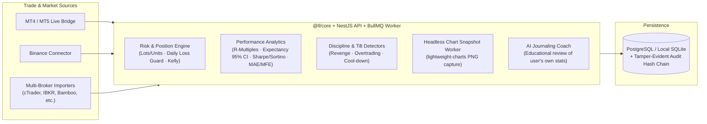

# Lolo's Ledger — Multi-Asset Trading Journal, Risk Engine & AI Performance Coach

> Combines my local-first desktop trading journal (FXLedger v1.1.0, archived desktop predecessor — **521/521 unit tests + 25 Playwright e2e tests passing**) with a full-stack NestJS + React + BullMQ monorepo featuring position-sizing risk guards, automated OHLC trade snapshots, and an educational AI journaling coach.

- **Desktop predecessor (archived):** FXLedger v1.1.0 — repository archived; not linked.
- **Current codebase:** Lolo's Ledger (private repository; this page is the public case study).
- **Role & Ownership:** Personal product built by Precious Ikebude (source private).

---

## 1. Problem

Retail and prop-firm traders across forex, crypto, indices, commodities, and equities lose capital primarily through position-sizing mistakes, breaking daily drawdown rules, and failing to review losing streaks objectively. Most cloud journals require expensive subscriptions, lock user data away, or push "AI trading signals" instead of helping traders measure and enforce their own process.

**Lolo's Ledger** focuses strictly on **risk discipline, quantitative trade attribution, and behavioural review**:
- **Never generates buy/sell signals or price predictions.**
- Enforces position sizing, daily loss limits, and pre-trade checklists before a trade is placed.

---

## 2. Architecture

---

## 3. Verification & Engineering Highlights

- **521 Passing Unit Tests & 25 Playwright E2E Tests (Desktop v1.1.0):** Covers R-multiple expectancy with 95% confidence intervals, Sharpe/Sortino/Calmar ratios, MAE/MFE excursion tracking, prop-firm daily-loss circuit breakers, fuzzy-header CSV importers, and tamper-evident SHA-256 audit-log sealing.
- **Full-Stack Monorepo (`pnpm` + `Turborepo`):** Shared TypeScript `@ll/core` math/risk package, NestJS REST + webhook API (`services/api`), BullMQ background worker, PostgreSQL + Redis (`docker-compose`), and React + TanStack Router web UI (`apps/web`).
- **Offline-First & Model-Gated AI:** Local Whisper voice-memo transcription and local screenshot OCR degrade gracefully when offline; the LLM coach strictly reviews user journal data with `"Educational, not financial advice"` guardrails.
