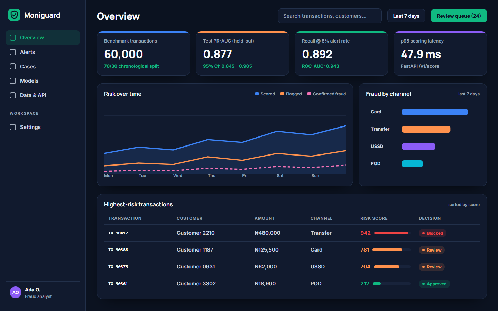
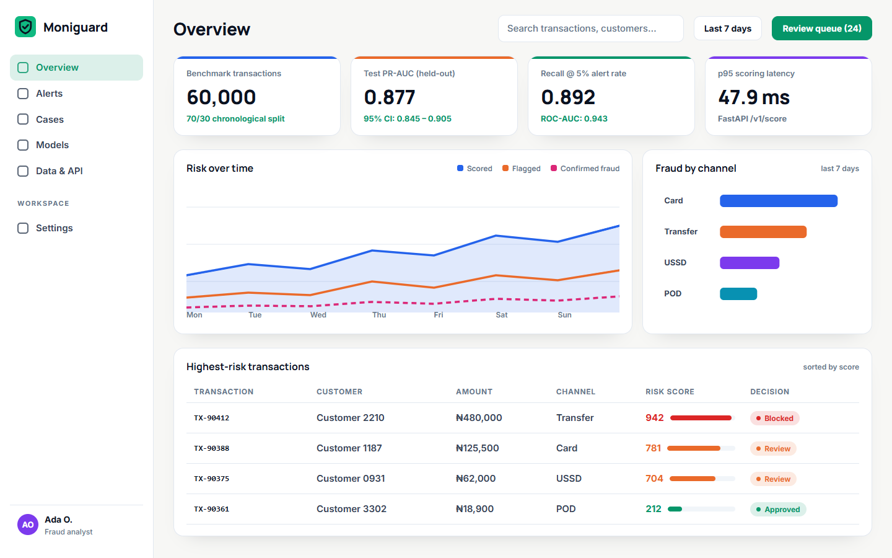
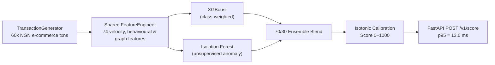

# Moniguard — Real-Time Fraud Detection for Nigerian E-Commerce

> Scores pay-on-delivery and digital transactions 0–1000 for fraud risk. On the repo's 60,000-transaction **synthetic** time-split benchmark, the calibrated XGBoost + Isolation Forest ensemble reaches **PR-AUC 0.875** (95% CI 0.841–0.898) and **Recall@5% alert rate of 0.895**, served via FastAPI at **13.0 ms p95 latency**.

- **Product Repository:** [`github.com/ikebude/MLOps-Fraud-Detection`](https://github.com/ikebude/MLOps-Fraud-Detection)
- **Role & Ownership:** Personal open-source product built by Precious Ikebude (MIT Licence).

| Dark Mode — Analyst Overview | Light Mode — Analyst Overview |
|---|---|
|  |  |

---

## 1. Problem

Nigerian pay-on-delivery (PoD) e-commerce and mobile-money merchants face fraud patterns that look different from standard card-present fraud: phone-number recycling, delivery-address clustering, sudden new-device logins before high-value orders, and refund abuse. Merchants need a real-time 0–1000 risk score and plain-language reason codes per transaction (`approve`, `review`, `block`) rather than a static ruleset or a post-mortem report.

---

## 2. Data

- **Source:** `producer/main.py` (`TransactionGenerator`) in [`ikebude/MLOps-Fraud-Detection`](https://github.com/ikebude/MLOps-Fraud-Detection)
- **Size:** 60,000 synthetic Nigerian e-commerce transactions across 500 users, 300 devices, and 50 vendors (`~2.66%` fraud rate across 6 injected fraud patterns: `card_fraud`, `account_takeover`, `refund_abuse`, `identity_theft`, `triangulation`, `friendly_fraud`)
- **Split:** Strict chronological time-based split — earliest 70% (`42,000` txns, `2.68%` fraud) for training, latest 30% (`18,000` txns, `2.62%` fraud) for held-out testing
- **Note on data honesty:** Metrics below are measured on the repo's reproducible synthetic generator (`make demo`). Benchmarking against public Kaggle datasets (PaySim and IEEE-CIS) is documented as the next milestone once a Kaggle token is attached.

---

## 3. Approach



- **Zero training/serving skew:** `src/utils/feature_engineering.FeatureEngineer` computes the exact same 74 features (velocity windows, amount z-scores, device/IP/phone sharing counts, `fraud_ring_score`) in both offline training and live FastAPI scoring.
- **Calibrated ensemble:** Combines supervised class-weighted XGBoost (`0.7`) with unsupervised Isolation Forest (`0.3`), followed by isotonic calibration so thresholds map cleanly to `0–1000` risk bands.

---

## 4. Results (from `reports/metrics.json`)

| Metric | Value | 95% Bootstrap CI | Notes |
|---|---|---|---|
| **PR-AUC (held-out time-split test)** | **0.875** | `0.841 – 0.898` | Primary metric for imbalanced fraud (`2.90%` positive rate) |
| **ROC-AUC (held-out time-split test)** | **0.945** | `0.930 – 0.956` | — |
| **Recall @ 1% alert rate** | **0.341** | — | Catches 34.1% of fraud if analysts only review top 1% of traffic |
| **Recall @ 5% alert rate** | **0.895** | — | Catches 89.5% of fraud at a 5% review budget |
| **p95 Scoring Latency (`POST /v1/score`)** | **13.0 ms** | — | Single-transaction FastAPI scoring + reason codes |

---

## 5. How to Run

Clone the full product repository and run the one-command demo:

```bash
git clone https://github.com/ikebude/MLOps-Fraud-Detection.git
cd MLOps-Fraud-Detection
pip install -r requirements-demo.txt
python scripts/offline_train_demo.py
pytest -q tests/unit
```
