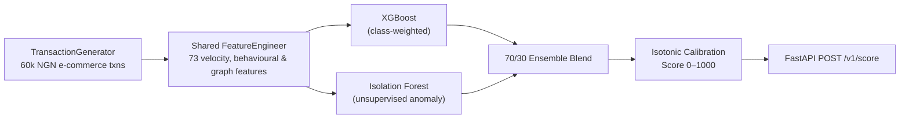

# Moniguard — Real-Time Fraud Detection for Nigerian E-Commerce

> Scores pay-on-delivery and digital transactions 0–1000 for fraud risk. On the repo's 60,000-transaction **synthetic** time-split benchmark, the calibrated XGBoost + Isolation Forest ensemble reaches **PR-AUC 0.959** (95% CI 0.942–0.972) in batch evaluation and **0.837** when each transaction is scored on its own through the FastAPI service, as in live use.

- **Product Repository:** [`github.com/ikebude/MLOps-Fraud-Detection`](https://github.com/ikebude/MLOps-Fraud-Detection)
- **Role & Ownership:** Personal open-source product built by Precious Ikebude (MIT Licence).

| Dark Mode — Analyst Overview | Light Mode — Analyst Overview |
|---|---|
|  |  |

---

## 1. Problem

Nigerian pay-on-delivery (PoD) e-commerce and mobile-money merchants face fraud patterns that look different from standard card-present fraud: phone-number recycling, delivery-address clustering, sudden new-device logins before high-value orders, and refund abuse. Merchants need a real-time 0–1000 risk score and plain-language reason codes per transaction (`approve`, `review`, `block`) rather than a static ruleset or a post-mortem report.

---

## 2. Data

- **Source:** `producer/main.py` (`TransactionGenerator`) in [`ikebude/MLOps-Fraud-Detection`](https://github.com/ikebude/MLOps-Fraud-Detection)
- **Size:** 60,000 synthetic Nigerian e-commerce transactions across 500 users, 300 devices, and 50 vendors (`~2.84%` fraud rate across 6 injected fraud patterns: `card_fraud`, `account_takeover`, `refund_abuse`, `identity_theft`, `triangulation`, `friendly_fraud`)
- **Split:** Strict chronological time-based split — earliest 70% (`42,000` txns, `2.82%` fraud) for training, latest 30% (`18,000` txns, `2.90%` fraud) for held-out testing. The last 15% of the training period is held back to fit the calibrator only
- **Note on data honesty:** Metrics below are measured on the repo's reproducible synthetic generator (`make demo`). Benchmarking against public Kaggle datasets (PaySim and IEEE-CIS) is documented as the next milestone once a Kaggle token is attached.

---

## 3. Approach



- **One feature definition:** `src/utils/feature_engineering.FeatureEngineer` computes the same 73 features (velocity windows, amount z-scores, device/IP/phone sharing counts) in offline training and live FastAPI scoring. Live scoring sees one transaction without the customer's history, so its per-customer features are weaker; that gap is measured below rather than hidden. A test checks that no feature changes when the labels are removed.
- **Calibrated ensemble:** Combines supervised class-weighted XGBoost (`0.7`) with unsupervised Isolation Forest (`0.3`), followed by isotonic calibration fitted on a held-out slice of the training period, so thresholds map cleanly to `0–1000` risk bands.

---

## 4. Results (from `reports/metrics.json`)

| Metric | Value | 95% Bootstrap CI | Notes |
|---|---|---|---|
| **PR-AUC (held-out time-split test, batch)** | **0.959** | `0.942 – 0.972` | Primary metric for imbalanced fraud (`2.90%` positive rate) |
| **ROC-AUC (held-out time-split test, batch)** | **0.996** | `0.992 – 0.999` | — |
| **Recall @ 1% alert rate** | **0.339** | — | The most any model could catch at a 1% budget is 0.345 |
| **Recall @ 5% alert rate** | **0.994** | — | Batch features |
| **PR-AUC through the API** | **0.837** | — | 3,000 test transactions scored one at a time via `/v1/score`, as in live use; recall @ 5% is 0.843 |

An audit on 1 November 2026 replaced the earlier figures (PR-AUC 0.875). The calibrator had been fitted on the model's own training predictions, and one feature (a vendor risk score) was built from the labels; both are fixed. No latency figure is quoted, because the last measurement was taken in a shared container and is not representative.

---

## 5. How to Run

Clone the full product repository and run the one-command demo:

```bash
git clone https://github.com/ikebude/MLOps-Fraud-Detection.git
cd MLOps-Fraud-Detection
pip install -r requirements-demo.txt -c constraints-demo.txt
python scripts/offline_train_demo.py
pytest -q tests/unit
```
