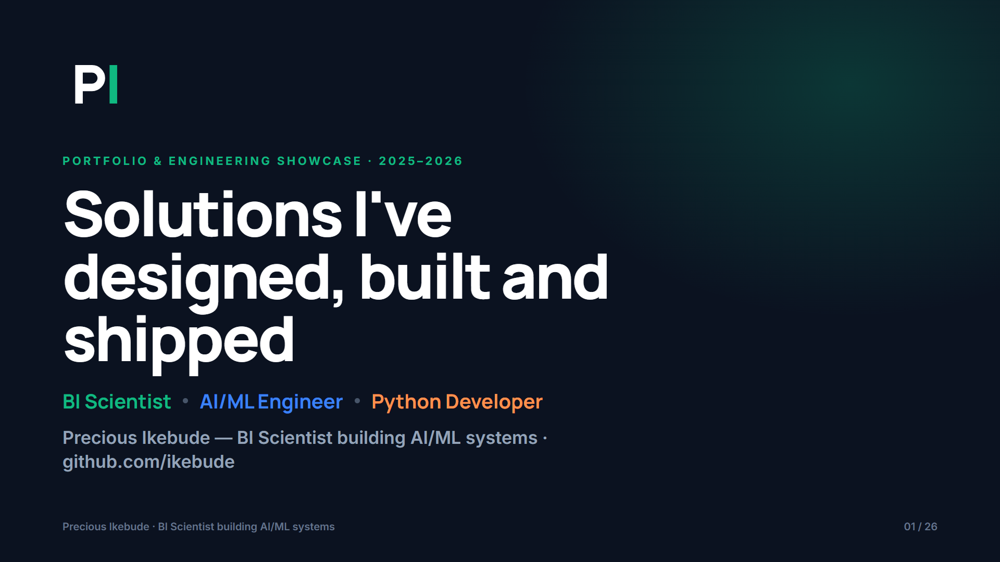
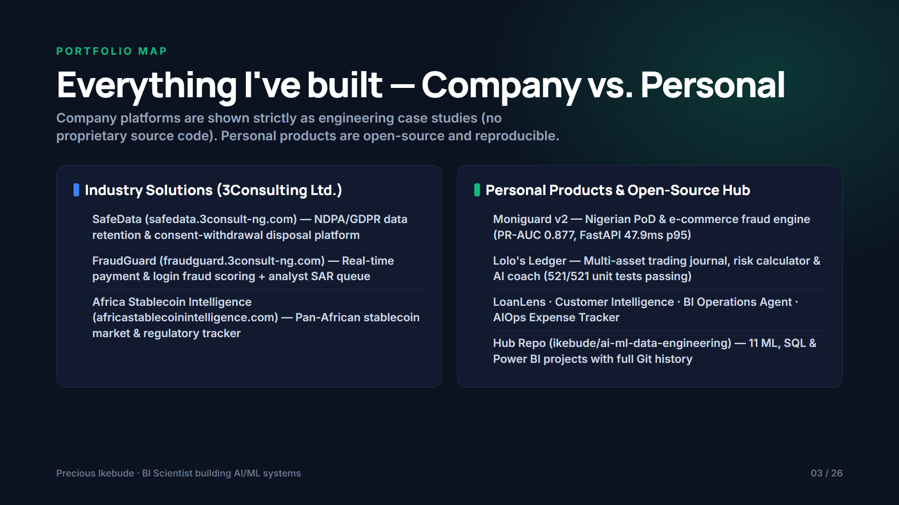
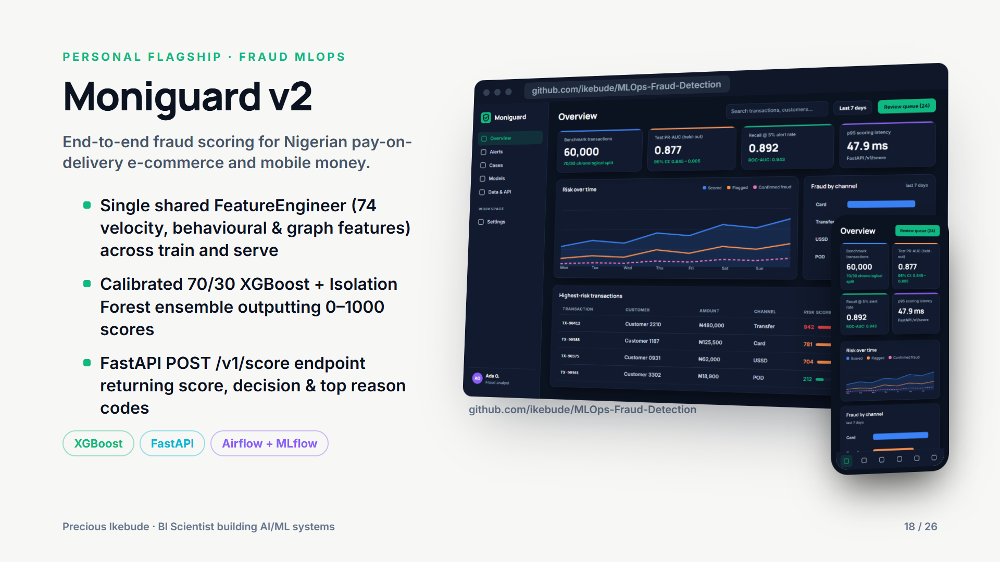
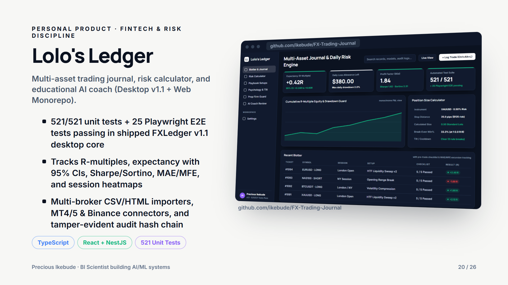
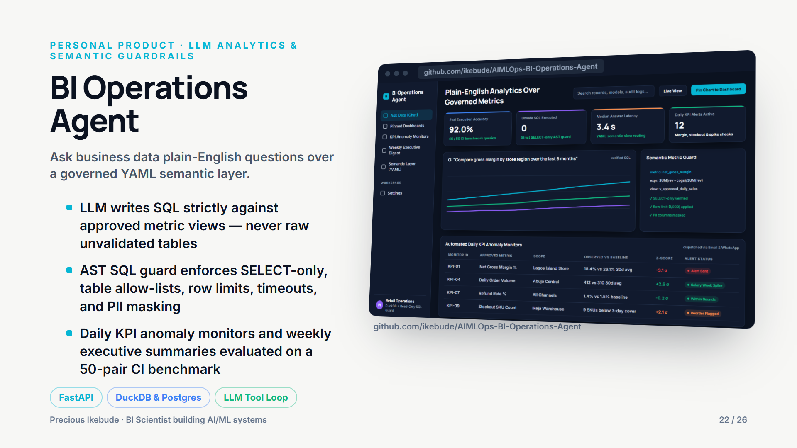
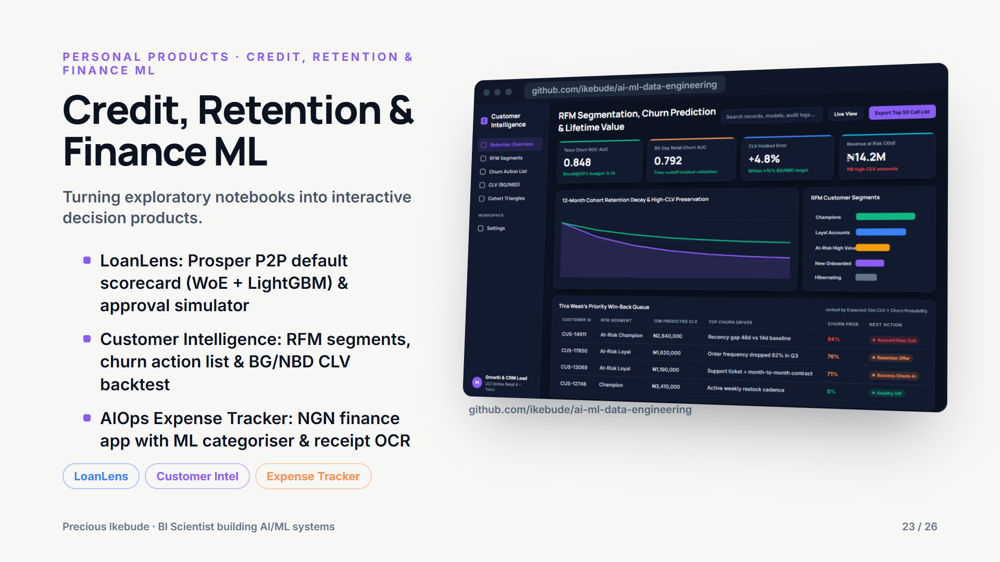

# Portfolio & Engineering Showcase Deck

> **"Solutions I've designed, built and shipped"** — 26-slide executive and technical walkthrough covering 3Consulting industry platforms, personal flagship products, and 11 ML/BI projects.

- **PowerPoint Deck (16:9 widescreen with speaker notes):** [`Precious-Ikebude-Solutions.pptx`](Precious-Ikebude-Solutions.pptx)
- **PDF Deck (16:9 print & LinkedIn Featured ready):** [`Precious-Ikebude-Solutions.pdf`](Precious-Ikebude-Solutions.pdf)
- **Brand Assets (`PI` and `CI` monograms):** [`brand/`](brand/)

---

## Known issues in these files (audit 2026-11-01)

The PDFs and the PPTX are images rendered from a generator kept in the owner's private working repository. The nine case-study carousels were corrected and re-rendered on 2026-11-01; the deck and the LinkedIn carousel were not. Until they are re-rendered, do not share the items marked **do not share**.

| File | What changed on 2026-11-01 | Status |
|---|---|---|
| `carousels/01-SafeData-…pdf` | "Live Platform", "Production", "Full compliance", 85% and 1M+ removed; says deployment pending verification and shows what is built | fixed |
| `carousels/02-FraudGuard-…pdf` | "Live Platform", "Production", <50 ms, −65%, −48% removed; architecture now matches the case study (outbox, Kafka, ensemble); deployment pending verification | fixed |
| `carousels/03-Africa-Stablecoin-Intelligence-…pdf` | "Live Platform", "Live exchange scrapers", 54/54 and 12+ removed; describes the market, country and editorial features; deployment pending verification | fixed |
| `carousels/04-Moniguard-v2-…pdf` | Labelled synthetic throughout; shows batch PR-AUC 0.959 and API-path PR-AUC 0.837 from `reports/metrics.json` on the Moniguard audit branch; "Production ML", "60% of Nigerian e-commerce", SHAP and PSI claims removed | fixed (numbers assume the Moniguard audit branch is merged) |
| `carousels/05-Lolos-Ledger-…pdf` | No link to the private repository; sample-journal P&L removed; shows the risk engine's worked examples, labelled synthetic | fixed |
| `carousels/06-BI-Operations-Agent-…pdf` | Latency updated to the report (18.8 ms median, 39.1 ms p95); dataset labelled synthetic | fixed |
| `carousels/07-LoanLens-…pdf` | Net yield +6.61%, approved-loan default 16.9%, homeowner gap 1.8 points, as in the report | fixed |
| `carousels/08-Customer-Intelligence-…pdf` | Broken LaTeX fixed; CLV backtest labelled synthetic | fixed |
| `carousels/09-AIOps-Expense-Tracker-…pdf` | "OCR" removed (the product parses text), Moniepoint removed (not a supported bank), data labelled synthetic | fixed |
| `Precious-Ikebude-Solutions.pptx` / `.pdf` | Speaker notes say "Live at africastablecoinintelligence.com", "Junior Data Analyst" (now BI Scientist || AI/ML Engineer), 521/521 tests, LoanLens "LightGBM" (it uses HistGradientBoosting) and "receipt OCR" (the product parses text); Moniguard slide has the older numbers | fix before sharing |
| `Precious-Ikebude-LinkedIn-Carousel.pdf` (12 slides, Oct 2026) | Old Moniguard numbers (PR-AUC 0.877, 47.9 ms p95), 521/521 tests, LightGBM and receipt OCR, a second (Gmail) address, and "Microsoft Azure AI Engineer (In View)", which is now only planned | **do not share** |

## Preview Slides

| Cover | Portfolio Map (Company vs. Personal) |
|---|---|
|  |  |

| Moniguard v2 (Nigerian PoD Fraud MLOps) | Lolo's Ledger (Multi-Asset Trading Journal & Risk Engine) |
|---|---|
|  |  |

| BI Operations Agent (Safe NL-to-SQL Copilot) | LoanLens, Customer Intelligence & AIOps Expense Tracker |
|---|---|
|  |  |

---

## Slide Outline (26 Slides)

1. **Cover:** *Solutions I've designed, built and shipped — BI Scientist · AI/ML Engineer · Python Developer*
2. **About Me:** How BI thinking and ML engineering fit together
3. **Map of Work:** Company platforms (case studies only, zero proprietary code) vs. Personal products
4. **Section I:** *Industry Work at 3Consulting Limited*
5. **SafeData (`safedata.3consult-ng.com`):** NDPA/GDPR data-retention & consent-withdrawal disposal platform
6. **SafeData Architecture:** Policy engine, automated SLA timers, and cryptographic disposal certificates
7. **SafeData Dashboard:** Compliance workspace, legal-hold guardrails, and immutable audit trail
8. **SafeData Engineering:** Hardening, 3-state circuit breakers, and multi-tenant isolation
9. **SafeData Impact:** Compliance velocity and zero-trust audit readiness
10. **FraudGuard (`fraudguard.3consult-ng.com`):** Real-time payment & login fraud scoring + analyst SAR queue
11. **FraudGuard Workspace:** Explainable risk scoring (`0–100`), device fingerprinting, and case triage
12. **FraudGuard Topology:** Network link analysis for mule rings, shared devices, and velocity bursts
13. **FraudGuard Architecture:** Hybrid rule + calibrated ML ensemble with sub-second API scoring
14. **Africa Stablecoin Intelligence (`africastablecoinintelligence.com`):** Pan-African stablecoin market & regulatory tracker
15. **Africa Stablecoin Coverage:** Corridor metrics, 54-country regulatory posture, and editorial CMS
16. **Africa Stablecoin Takeaway:** Separating market signal from regulatory policy across African corridors
17. **Section II:** *Personal Products Hub*
18. **Moniguard v2 (`ikebude/MLOps-Fraud-Detection`):** Nigerian PoD & mobile-money fraud MLOps platform
19. **Moniguard v2 Benchmark:** `PR-AUC 0.875` (95% CI `0.841–0.898`), `ROC-AUC 0.945`, `Recall@5% = 0.895`, `13.0 ms` p95 latency on 60,000 **synthetic** chronological transactions
20. **Lolo's Ledger:** Multi-asset trading journal, live position-size calculator, and rule-based AI coach (the deck slide still cites the desktop predecessor's `521/521` tests; see the case study for the current state)
21. **Lolo's Ledger Risk Engine:** Pre-trade account risk guardrails (`0.25%–2.0%`), expectancy (`E[R]`), and Tilt Index detection
22. **BI Operations Agent (`ikebude/AIMLOps-BI-Operations-Agent`):** Read-only NL-to-SQL copilot with AST validation and anomaly z-score cards
23. **Credit, Retention & Finance ML:** LoanLens (Prosper WoE scorecard + gradient boosting; the deck says LightGBM), Customer Intelligence (RFM + Churn + BG/NBD CLV), and AIOps Expense Tracker (NGN categoriser + receipt-text parsing; the deck says OCR, which the product does not do)
24. **Portfolio Hub Gallery (`ikebude/ai-ml-data-engineering`):** 11 ML, SQL, and Power BI repositories with full commit history
25. **How I Build:** Honest time-based evaluation, CI/CD + Docker reproducibility, and strict IP/security boundaries
26. **Contact:** Direct links, credentials, and availability
